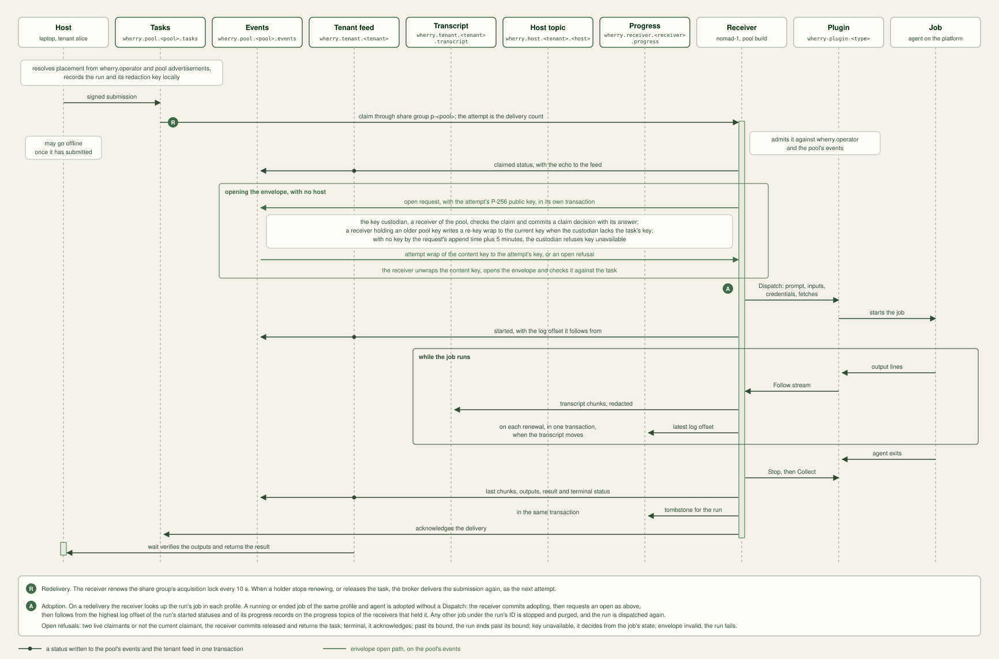

# Key concepts

[Introduction](introduction.md) states the problem wherry solves.
[Design](design.md) covers its topics and configuration delivery, and
[Security](security.md) its credential envelopes.

## Roles

- **The operator** runs `wherry operator`. It issues every Kafka principal,
  grants every ACL, and writes the records on `wherry.operator` that define
  pools, receivers, hosts and entitlements. The operator is close to root:
  `wherry operator init` uses the Kafka super user once to create the
  principal `wherry.operator`, whose `Alter` on the cluster lets it grant
  any ACL, and every later command connects as `wherry.operator`.
- **A tenant** submits work. Each tenant has one or more **hosts**,
  machines that run the `wherry` CLI or its MCP server. Each host is its
  own Kafka principal with its own Ed25519 signing key. A compromised host
  is a compromise of its tenant.
- **A pool** is a set of receivers that share terms and trust each other fully.
  Its terms name the agents it runs, the credentials each agent takes and their targets, the
  share-group delivery limit and lock duration, and the quotas its tenants'
  hosts get. A tenant is entitled to one or more pools. A host entitled through
  several pools gets the lowest of their quotas.
- **A receiver** is a long-running `wherry receiver run` process in one pool.
  It claims tasks, runs each as a platform job, and publishes the job's
  statuses, transcript and result. Each receiver is its own principal with
  an Ed25519 signing key, which it creates on first start and keeps in its
  state directory.
- **A plugin** is the binary `wherry-plugin-<type>` that runs
  jobs on one kind of platform. The receiver ships with none, and runs one
  plugin process per plugin from its plugin directory, linked to it
  by mutual TLS. Plugins exist for Nomad, Kubernetes and systemd.
- **A plugin profile** is a named, configured use of a plugin: the agent it
  launches, its labels and its runtime. A task is placed on a profile and a
  run is routed to one. A receiver holds one or more profiles, and each
  profile launches one agent.
- **The agent** is the program a job runs, such as a coding agent's
  headless command. wherry does not modify it. The receiver passes it a
  prompt file and reads its standard output.

One person can hold every role in a development setup.

## Identity and authorisation

Identity is a Kafka principal authenticated with
[SCRAM-SHA-512](https://kafka.apache.org/documentation/#security_sasl_scram)
over TLS. `wherry operator` creates each host and receiver principal, sets a
generated password, and writes a **bundle**: a file, mode 0600, holding the
broker address, the principal and its password, and no CA: each machine
trusts the broker through the system roots or a CA file in its own
configuration. The operator hands the bundle to the host or receiver. It never travels over Kafka.

| Principal | Name |
| --- | --- |
| host | `wherry.tnt.<tenant>.<host>` |
| receiver | `wherry.rcv.<receiver>` |
| operator | `wherry.operator` |

Authorisation is
[Kafka ACLs](https://kafka.apache.org/documentation/#security_authz), enforced
by the broker. `wherry operator` generates every host and receiver ACL from
the state on `wherry.operator`. Each names one resource literally, except one
prefixed grant per receiver on its pool's transactional IDs.
`wherry.operator`'s own grants come from `operator init`, and two of them
are prefixed: topics `wherry.` and groups `p-`
([The operator principal](security.md#the-operator-principal)). The `wherry operator` command that
records a host or receiver on `wherry.operator` also issues its principal and ACLs,
and `pool entitle` records an entitlement with its ACLs; no other approval step
exists. [Design](design.md#acls) lists the matrix.

## Placement

A task names an **agent** and a **selector**. The agent is a name from the
pool's terms; it is the one thing wherry itself interprets. The selector
is a list of requirements over labels, in the style of
[Kubernetes set-based selectors](https://kubernetes.io/docs/concepts/overview/working-with-objects/labels/#set-based-requirement).
The operators are `In`, `NotIn`, `Exists` and `DoesNotExist`;
[Commands](commands.md#selectors) gives the grammar.

**Labels describe characteristics**, such as a GPU, a network segment or an
isolation level. The operator declares them per plugin profile in the receiver's
configuration record. Keys are arbitrary and may carry the operator's own
prefix, such as `example.com/gpu`; the prefix `wherry.io/` is reserved.
Two profiles can launch the same agent with different labels, such as one
in containers and one on the host.
The platform, runtime, node pool and datacenter a profile uses are part
of its configuration, and are neither labels nor selectable.

**The client resolves placement before it signs.** It reads the receiver
configurations on `wherry.operator` for their labels, and the advertisements on
`wherry.receivers` for liveness, capacity and which profiles are ready. A
receiver whose latest advertisement is at most 120 seconds old is live. For each
live receiver in a pool the tenant is entitled to, the client looks for a ready
profile that launches the agent with labels the selector accepts. With no agent
named, each receiver takes the pool's default agent if a ready profile launches
it, otherwise the first other agent in the terms' order that one does. A
receiver that would run its pool's default agent wins over any receiver that
would run another agent. Among the receivers that remain, the one with the most
spare capacity wins, and ties go to the lowest receiver ID. The client
signs the agent, the selector and the chosen pool into the task.

**The receiver routes** a task it claims to its first ready profile, in
order within its plugin, whose agent and labels satisfy the task. It visits
plugins in the order of their names, the same order the client uses, and
labels choose between plugins. An agent outside
the pool's terms is rejected. A task no ready profile satisfies is a start
failure: the receiver records it on the pool's events and returns the task
to the pool. The client places a task by one member's labels, but any
member of the pool can claim it, so every member must honour the labels its
profiles declare.

## Files in and out

Everything the task receives lands as files. A submission's `raw` and
`data` parts are input files that the agent finds in the directory
`WHERRY_INPUT_DIR` names. They travel inline in the submission record,
within the broker's record limit, which `pool apply` records, and the
limit each plugin profile declares. Over either, they go through S3 when the pool
has storage and the host a storage credential; otherwise submit refuses,
naming the limit. Credentials are files in the directory
`WHERRY_CREDENTIALS_DIR` names or environment variables, each at its
target. The receiver opens the prompt with the names of the files, the
credentials' targets and the outputs the task expects.

The agent leaves its outputs in the directory `WHERRY_OUTPUT_DIR` names.
Once the job ends and is stopped, whatever its exit, the plugin
collects the regular files there, up to 256 entries and the pool's output
limit (8 MiB by default), without
following links. The receiver redacts each file, publishes it in chunks on
the tenant's transcript topic in the result's transaction, and lists every
output in the result with the size and SHA-256 it computed, or with the
reason it was not returned. A required output that is not returned fails
the run. `wherry wait` verifies each output's chunks against the result
before it writes the file locally.

A pool can also carry files through an S3-compatible bucket its operator
names, up to 5 GiB each. The host uploads an S3 input with its own
credential before it publishes the task, and the task carries only the
input's name, size and SHA-256. At submit, the host presigns a short-lived
GET per input and a PUT per expected S3 output, and encrypts them with the
credentials in the task's envelope, so the URLs never sit on the broker in
the clear. The receiver checks each URL against the pool's
endpoint and bucket; the plugin fetches the inputs into the input
directory and verifies them; the receiver streams each S3 output to its
PUT URL, hashing what it sends, and lists it in the result. The host then
downloads and verifies the outputs and deletes the run's objects. The
host's storage credential never leaves the host, and S3 outputs, which go
to the host's own bucket, are not redacted.

A task can also name a git repository: a remote and a ref. The host's
`git` configuration gives the clone its credential and, for `ssh`, its host
key: the entry whose URL is the longest prefix of the remote. The credential
joins the task as a task credential in the file `git-credential`. The URL
prefix is the credential's scope, since every task cloning under it receives
the credential. A remote under no entry clones anonymously. The agent clones
it with `git` itself; wherry runs no git. The receiver delivers the host key
as the input file `known_hosts` and opens the prompt with the clone
commands, which read the credential from its file. The remote's host must
be one of the pool's VCS hosts. The agent returns its commits as a patch
or a bundle output, which the parent applies with its own credentials, or
pushes them to the branch `wherry/<run>` when the parent asks and its
credential allows.

## Runs and attempts

A run is one task from submission to its final state. It is one signed
submission and one execution, which ends in a terminal state. A receiver
may attempt that execution more than once.

Each pool reads its tasks through the Kafka
[share group](https://cwiki.apache.org/confluence/display/KAFKA/KIP-932%3A+Queues+for+Kafka)
`p-<pool>`. A receiver holds a claimed task through the share group's
acquisition lock for the whole run and renews it every 10 seconds. When a
receiver stops renewing, the broker delivers the task again, and that
delivery is the next attempt. The receiver that takes it looks for the
run's job in each of its plugin profiles. If the job exists and came from the
same profile and agent, as its platform metadata records, the receiver adopts it, opens the envelope for its own attempt,
and once it opens resumes the transcript from the run's latest committed
offset, which each holder records on its own progress topic,
`wherry.receiver.<receiver>.progress`. Any other job under the
run's ID is stopped and purged, and the run is dispatched again. Each
run writes through its own
[transactional producer](https://kafka.apache.org/documentation/#semantics),
`p.<pool>.<run>`, so an adopter fences the earlier holder's writes.

A status goes to the pool's events and the tenant feed in one transaction,
and every reader reads committed records only. The result and the **echo**
go to the tenant feed, and transcript and output chunks go to the tenant's
transcript topic, `wherry.tenant.<tenant>.transcript`, in the same
transaction as the status, result or progress record they belong to. While
the job runs, the receiver records the run's latest committed transcript
offset on its progress topic every 10 seconds. A terminal status carries
the number of transcript chunks its attempt wrote. The echo, written when a
receiver claims or rejects a run, names the pool and placement the run was
admitted to, so any host of the tenant can follow or cancel the run. The submitting
host also keeps a record of each run in its state directory, so it can report the
run before a receiver claims it.

A run passes through these records from submission to result.

## Pool keys and the key custodian

A run's credentials have to reach whichever receiver of the pool claims
it, at any attempt, after the submitting host may have gone offline, and
the broker must not hold them in the clear. Each pool therefore has a key
pair held by one of its receivers, the pool's **key custodian**.

At submit the host encrypts the run's credentials, its presigned S3 links
and its redaction key in the task's envelope, and wraps the envelope's
content key to the pool's current public key
([Credential envelopes](security.md#credential-envelopes)). A receiver that
claims the task asks the key custodian to open it. The custodian checks the
claim and wraps the content key to a key the receiver made for that one
attempt. No host answers anything after submit.

**Selection.** Every receiver of the pool joins the pool's custodian group,
`p-<pool>.custodian`, a Kafka consumer group on the pool's snapshot topic,
`wherry.pool.<pool>.custodian`, which has one partition. The group assigns
the partition to one member, and that member is the key custodian; any
receiver of the pool can become it. Each receiver joins as a
[static member](https://cwiki.apache.org/confluence/display/KAFKA/KIP-345%3A+Introduce+static+membership+protocol+to+reduce+consumer+rebalances)
under its receiver ID, so a custodian that crashes and restarts within the
group's 45-second session timeout keeps the assignment, and with its state
directory keeps its key. A receiver that stops on a signal or a
configuration change leaves the group instead, so the group assigns the
partition to another member at once. The custodian holds the pool's P-256 private keys in its
state directory. It publishes the current public key in a signed
**snapshot** on the snapshot topic, through the transactional ID
`p.<pool>.custodian` that every receiver of the pool shares, so a new
custodian's first transaction fences the previous custodian's writes. A host
encrypts to the key in the latest committed snapshot. Custody follows the
custodian group's session alone: a custodian whose session ends, after the
group's 45-second session timeout for a crash, is replaced, and
advertisements only place tasks.

Each snapshot states why it was published:

| Reason | Published when |
| --- | --- |
| `bootstrap` | the pool's first custodian publishes its first key |
| `rotation` | the custodian rotates its key, daily or on `wherry operator pool rotate-key` |
| `takeover` | a receiver becomes custodian after another: the previous custodian drained, crashed, or came back without its state directory |
| `contested` | the custodian finds its writes fenced while the group still assigns it the partition |

A receiver assigned the partition that the current snapshot already names,
and that still holds the snapshot's key, continues with that key. Every
`takeover` and `contested` snapshot raises
[WherryCustodianTakeover](runbooks.md#wherrycustodiantakeover), and hosts
log it. Every custodian change raises the alert, a planned drain's included.
The group coordinates honest receivers. It does not authenticate custody
against a malicious member of the pool
([What the pool key protects](security.md#what-the-pool-key-protects)).

### Rotation

The custodian rotates the pool key daily, at the append time of the
snapshot that first published the key plus 24 hours plus a jitter under one
hour derived from the pool and the key ID. A suspended pool's key also
rotates at once on
[`wherry operator pool rotate-key`](commands.md#wherry-operator-pool-rotate-key-pool-suspect-key-kid).
A rotation publishes a `rotation` snapshot with a new key, and hosts encrypt
to the new key once they read it.

Tasks already queued under a replaced key still open. The custodian, and
every former custodian that did not re-key its tasks in a drain, keeps each key it held until
that key's deadline:
the append time of the snapshot that replaced it plus the pool's
`start_by_limit` plus 7 hours, the six-hour run cap and an hour's margin. A
task's `task_started_by` is within `start_by_limit` of its submission, so
the key outlives every task wrapped to it, and the deadline falls inside the
pool topics' [retention](operations.md#retention). A receiver holding a
replaced key answers an open request for a task under that key with a
re-key wrap to the current key, which the custodian then opens.
[`wherry receiver run`](commands.md#wherry-receiver-run) states the
deadlines a receiver sets after a crash.

### Planned drain and re-key

A receiver that stops on `SIGINT` or `SIGTERM`, or for a configuration
change, leaves the custodian group, so the group assigns the partition to
another member. A stopping custodian with a `drain_timeout` over `0s` leaves
the group and waits up to `drain_timeout` for a successor's snapshot. The
successor publishes a `takeover`, as for any custodian change, and raises
[WherryCustodianTakeover](runbooks.md#wherrycustodiantakeover). The draining custodian
then re-keys to the successor's key, in one transaction, every task its keys
open that is its run's task, or any admissible task of a run that has none, not
terminal and not past its `task_ended_by`, once for each task hash, and deletes
its pool keys. Every step of the drain ends
within `drain_timeout` plus 5 seconds of the stop, so the stop fits the
platform's kill window as
[Drain timeout and the stop window](configuration.md#drain-timeout-and-the-stop-window)
describes.

A task appended under the draining custodian's key after its re-key
scan is not re-keyed: it fails before it starts and its host resubmits it,
as for a [lost key](#lost-pool-keys). A scan or write error keeps the keys
to their deadlines, and so does a drain while the pool is suspended, which
scans nothing.

With `drain_timeout` at `0s`, or with no successor's snapshot by the
deadline, the custodian exits with its keys and the next custodian
publishes a `takeover`. The custodian does not know whether a successor
will come: with no other member, as in a one-receiver pool, a scale to zero
or a whole-pool stop, it waits out `drain_timeout` within the stop window and
then exits with its keys, and its restart continues as custodian.
Permanently removing a pool's only receiver loses its keys. A former custodian that stays up answers open
requests for tasks under its keys with re-key wraps until their deadlines.
[Stop a pool's key custodian](operations.md#stop-a-pool-s-key-custodian)
gives the procedure.

### Lost pool keys

A task wrapped to a key that no running receiver holds cannot open: its
custodian lost its state directory, was killed before its drain re-keyed its tasks, or was
the pool's only receiver and was removed. The next custodian publishes a
`takeover` with a new key. When the task is claimed, the custodian waits up
to 5 minutes for a holder's re-key wrap and then refuses the open request
`key unavailable`. The claimant decides from the run's job:

- A run that never started, on its first delivery or when the plugin's
  Lookup finds no job or one that never started, ends `TASK_STATE_FAILED`
  with `cannot be opened: the pool's custodian changed and its key was lost`
  and the wherry event `key-lost`, and raises
  [WherryRunsKeyLost](runbooks.md#wherryrunskeylost).
- A run whose job exists has its job stopped and ends with the same
  message, without `key-lost`. An adopter asks once more before it stops
  the job.
- While Lookup cannot answer, the run is reconciling: the claimant records a
  `reconciling` status and keeps asking while it holds the claim, until
  Lookup answers or `task_ended_by` passes. A later claimant continues the
  same way and never dispatches.

The host that submitted a `key-lost` run resubmits it, until the run's
`task_started_by`. `submit` and `status` without a run ID, and the MCP
server's `submit` and `status` without one, resubmit every such run of the
host; `status RUN_ID`, `wait RUN_ID` and `logs -f RUN_ID`, and the MCP
server's `status` and `wait` for a run, resubmit the run they name. The replacement is a new
run under the pool's current key, with the credentials resolved again from
the host's sources, the same message, placement, outputs and absolute
bounds, and `replaces` naming the failed run. `wait` and the MCP server
follow the chain of replacements and report every run ID, and
`wherry status RUN_ID` shows `replaced_by=<run>`.
[Resubmission](a2a-extension-v1.md#resubmission) specifies it. To resubmit,
the host keeps each run's task content in its state directory: the
submission without its envelope and wrap, and the run's redaction key. It
keeps no credential value in the clear and no content key.

Custodian loss gives a weaker guarantee than receiver loss:

- a never-started task under a lost key runs only when its host comes back
  before the task's `task_started_by`; a host that never returns loses it;
- a running task under a lost key whose receiver dies fails, since no
  adopter can open its envelope;
- between a custodian crashing and its successor's snapshot, up to the
  group's 45-second session timeout, hosts still submit under the crashed
  custodian's key, and those tasks fail key-lost and are resubmitted as
  above.

### Suspension

Suspending a pool stops new work on it while its running jobs complete and
its key custody keeps working, so an operator can contain a compromise.
[`wherry operator pool suspend`](commands.md#wherry-operator-pool-suspend-pool)
withdraws the hosts' Write on the pool's tasks topic. The receivers keep
Read, and every other grant stays. Hosts refuse to submit to the pool, and
receivers claim nothing from it. The custodian refuses with
`pool suspended` the open request of a claim with no `adopting` status, so
that run's task goes back to the queue unstarted. `pool suspend` returns
once the key custodian has acknowledged the suspension in its snapshot;
after that no new start opens. Until then a pass that has not read the
record can still open a first start. A pool with no custodian yet returns
at once, and a custodian that does not acknowledge within 5 minutes fails
the command with the suspension not yet in effect. It serves adoptions of started jobs. Runs in progress continue to their
terminal status. A suspension takes back no
credential a running job holds: rotating the credential at its issuer does,
and revoking a receiver stops it. The custodian keeps rotating its key, and
`rotate-key` runs only on a suspended pool. `wherry operator pool resume`
restores the grants, and queued tasks run.
[Respond to a compromised receiver or pool key](operations.md#respond-to-a-compromised-receiver-or-pool-key)
gives the procedure.

## Cancellation

A cancel is a host-signed record on the pool's events that names a run.
A receiver reads cancels every 10 seconds, and checks them every second
for each run it holds. The receiver stops a running job, and a receiver
that claims a cancelled run starts no job. Either way the run ends in
`TASK_STATE_CANCELED`.

## Revocation

Revoking a host or receiver removes its access at the broker, in six
steps:

1. Record the principal as revoking on `wherry.operator`, then rotate its
   SCRAM password. From the revoking record on, the principal is granted
   no ACL, so an operator command that reconciles ACLs does not restore its
   grants. It stays a member until step 6.
2. Delete its ACLs.
3. Probe every broker as the principal, with the new password. While any
   broker still authorises it, the step probes again every second for up
   to 2 minutes, then fails. A refused login, as from a broker that has not
   yet applied the new password, is retried within the same 2 minutes. Any
   other probe error fails the step at once.
4. Delete its SCRAM credential.
5. Wait the longest of the broker's re-authentication, share-group lock
   and transaction timeout intervals. A longer wait can be asked for; a
   shorter one is refused.
6. Record its membership end on `wherry.operator`, then read
   `wherry.operator` to its end and delete again any ACL or credential a
   concurrent command restored.

No claim or write by the principal is authorised after step 5. A
revocation run again after a failed step continues from the revoking
record. Readers
reject its records once they read the step 6 record. A host also skips
every record a receiver wrote once that receiver's membership has ended,
including records it wrote before, so the runs it served lose that history
in `wait` and `events`.

A receiver exits at its first authorisation error, or once it reads its
membership ended. It stops claiming, serving open requests and key custody
at once, and leaves the jobs of the runs it holds running. Closing its
share sessions attempts to release their tasks: when the broker accepts
the release they are delivered again at once; otherwise, as under the
denial that stopped the receiver, they return when their locks lapse. On a pool-wide platform, such as Nomad or
Kubernetes, the next holder, the restarted receiver or another member,
adopts each job. A host-local platform, such as systemd, adopts only on the
same host: the receiver restarted under the same receiver ID adopts its
jobs, but a member on another host that claims a task starts a second job
once the [claim check](a2a-extension-v1.md#the-claim-check) no longer counts
the exited receiver a live claimant, as after a receiver crash. The
systemd plugin recommends a pool per receiver for this reason. The
receiver leaves the jobs for adoption: stopping them would bind only an
honest receiver, and a compromised one would ignore it.

A revoked principal does not return. A host or receiver that comes back is
provisioned under a new name, with a new principal and key topic.

A compromised key calls for revocation. A
[key rotation](operations.md#rotate-a-key) keeps the retired key
verifying the owner's feed and transcript records from before the
rotation.
