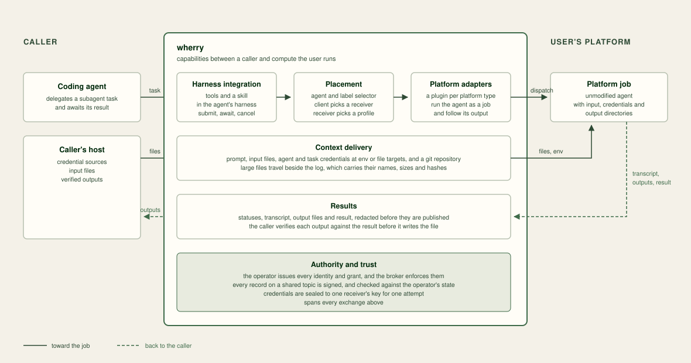
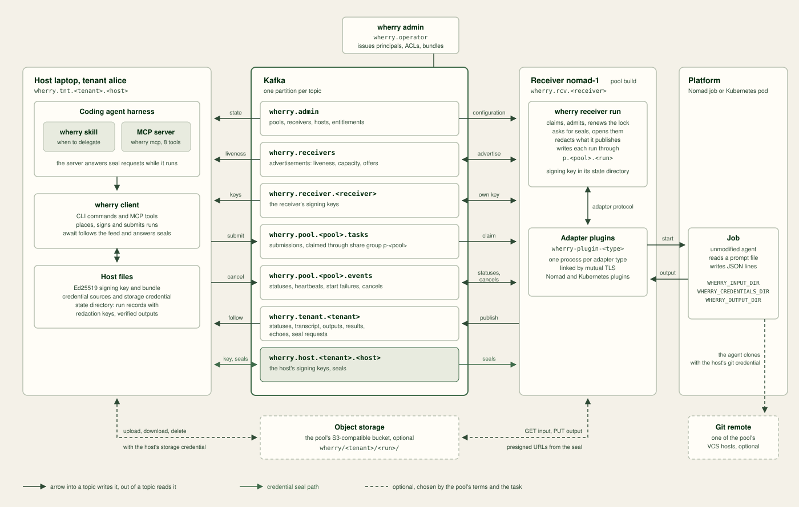
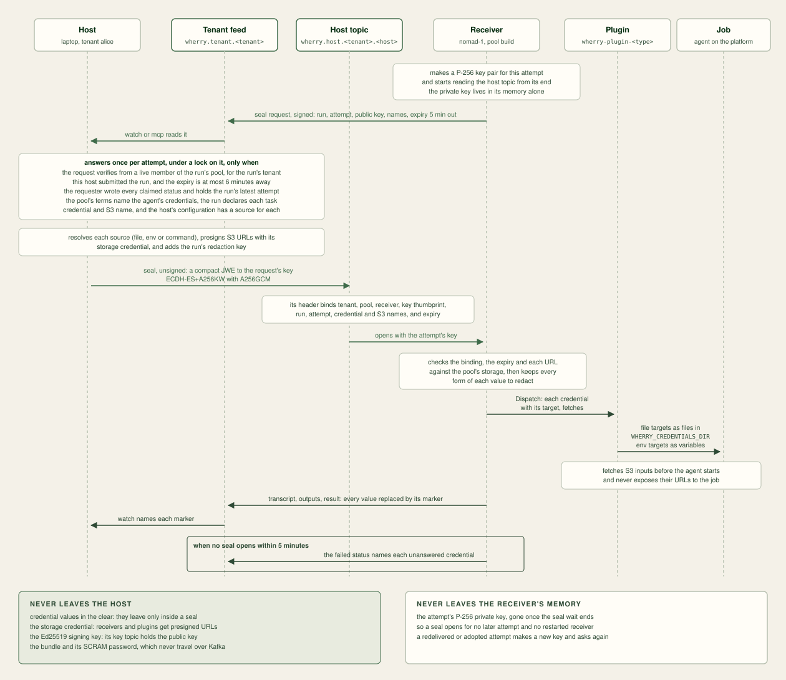
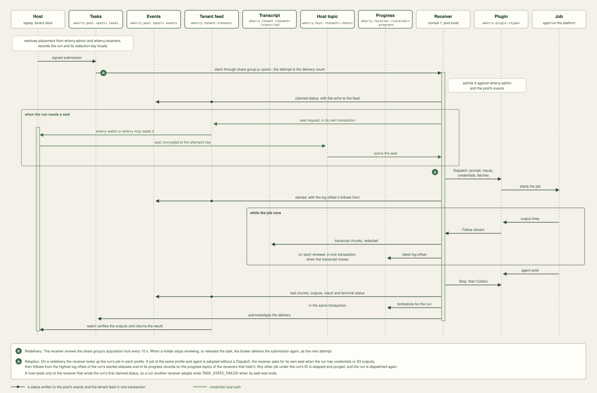

# Concepts

## The problem

A coding agent that delegates work runs its subagents on the machine the
agent itself runs on, or in the agent vendor's cloud. Neither is
infrastructure its user operates, so a subagent cannot use the user's own
clusters, hardware, network placement or isolation.

wherry sends a subagent task to a platform the user runs, starts an
unmodified agent there, and returns the result to the caller. Every
exchange is a record on a Kafka cluster the user also runs. Kafka supplies
identity, authorisation, isolation, history, work distribution and atomic
writes.

wherry's capabilities sit between the caller and the platform that runs
the agent.

## Roles

- **The operator** runs `wherry admin`. It issues every Kafka principal,
  grants every ACL, and writes the records on `wherry.admin` that define
  pools, receivers, hosts and entitlements. The operator is root: its
  admin credential can write any topic and grant any ACL.
- **A tenant** submits work. Each tenant has one or more **hosts**,
  machines that run the `wherry` CLI or its MCP server. Each host is its
  own Kafka principal with its own Ed25519 signing key. A compromised host
  is a compromise of its tenant.
- **A pool** is a set of receivers that share terms and trust each other fully.
  Its terms name the agents it runs, the credentials each agent takes, the
  share-group delivery limit and lock duration, and the quotas its tenants'
  hosts get. A tenant is entitled to one or more pools. A host entitled through
  several pools gets the lowest of their quotas.
- **A receiver** is a long-running `wherry receiver run` process in one pool.
  It claims tasks, runs each as a platform job, and publishes the job's
  statuses, transcript and result. Each receiver is its own principal with
  an Ed25519 signing key, which it creates on first start and keeps in its
  state directory.
- **An adapter** is the part of a receiver that runs jobs on one platform.
  Adapters are plugins: the receiver ships with none, and runs one plugin
  process per adapter type from its plugin directory, linked to it by
  mutual TLS. Plugins exist for Nomad and Kubernetes. A receiver holds one or more
  adapters, and each adapter launches one agent.
- **The agent** is the program a job runs, such as a coding agent's
  headless command. wherry does not modify it. The receiver passes it a
  prompt file and reads its standard output.

One person can hold every role in a development setup.

## Identity and authorisation

Identity is a Kafka principal authenticated with
[SCRAM-SHA-512](https://kafka.apache.org/documentation/#security_sasl_scram)
over TLS. `wherry admin` creates each host and receiver principal, sets a
generated password, and writes a **bundle**: a file, mode 0600, holding the
broker address, the broker's CA certificate, the principal and its
password, and for a receiver any platform credential its platform does not
issue by its own identity mechanism. The operator hands the bundle to the
host or receiver. It never travels over Kafka.

| Principal | Name |
| --- | --- |
| host | `wherry.tnt.<tenant>.<host>` |
| receiver | `wherry.rcv.<receiver>` |
| operator | `wherry.operator` |

Authorisation is
[Kafka ACLs](https://kafka.apache.org/documentation/#security_authz), enforced
by the broker. `wherry admin` generates every ACL from the state on
`wherry.admin`. Each names one resource literally, except one prefixed grant per
receiver on its pool's transactional IDs. The `wherry admin` command that
records a host or receiver on `wherry.admin` also issues its principal and ACLs,
and `pool entitle` records an entitlement with its ACLs; no other approval step
exists. [Reference](reference.md#acls) lists the matrix.

## Topics

Kafka cannot filter records on the broker, so records consumed
differently live on different topics.

| Topic | Writers | Readers | Holds |
| --- | --- | --- | --- |
| `wherry.admin` | the operator | every principal | pool terms, receiver configurations, hosts, entitlements, membership ends, skips |
| `wherry.receivers` | receivers | receivers, hosts | advertisements |
| `wherry.receiver.<receiver>` | that receiver | its pool's members, entitled tenants' hosts | its keys |
| `wherry.pool.<pool>.tasks` | entitled tenants' hosts | the pool's receivers, through its share group | submissions |
| `wherry.pool.<pool>.events` | the pool's receivers, entitled tenants' hosts | the pool's receivers | statuses, heartbeats, start failures, cancels |
| `wherry.tenant.<tenant>` | receivers of the tenant's pools | the tenant's hosts | statuses, transcript chunks, results, echoes, seal requests |
| `wherry.host.<tenant>.<host>` | that host | that host, receivers of the tenant's pools | its key, seals |

A host and a receiver read and write these topics as their grants allow,
beside the platform, object storage and git remote a run uses.

`wherry.admin` records and seals carry no signature: each sits on a topic only
one principal can write, so Kafka authenticates it. Every other record, key
records included, is a versioned EdDSA
[JWS](https://datatracker.ietf.org/doc/html/rfc7515). A record on a shared topic
names its owner and key in its `kid`, and a reader verifies it against that
owner's current key, read from the owner's own key topic, before it decodes the
payload. A host reading its tenant feed, and a receiver reading its pool's
statuses, also accept a key the owner has rotated away, for records the
broker appended before that rotation. No host or receiver can vouch for
another's key.

A reader then checks the record against `wherry.admin`. A submission or
cancel must come from a live host of a tenant entitled to the pool whose
topic it arrived on. A receiver record must come from a live member of the
pool the run was placed in, on behalf of a tenant entitled to it.
[The wherry A2A extension](a2a-extension-v1.md) specifies every record.

Every topic has one partition, `LogAppendTime` timestamps and
`cleanup.policy=delete`. Nothing is compacted and no topic is deleted. A
pool's task and event topics keep records for its maximum queue deadline plus six hours
plus a day, 15 days 6 hours by default, the tenant feed for 30 days and
`wherry.receivers` for 7; the identity and configuration topics keep them
forever.

Every principal reads all of `wherry.admin`, so tenants see each other's
names, hosts, entitlements and pools.

## Placement

A task names an **agent** and a **selector**. The agent is a name from the
pool's terms; it is the one thing wherry itself interprets. The selector
is a list of requirements over labels, in the style of
[Kubernetes set-based selectors](https://kubernetes.io/docs/concepts/overview/working-with-objects/labels/#set-based-requirement).
The operators are `In`, `NotIn`, `Exists` and `DoesNotExist`;
[Reference](reference.md#selectors) gives the grammar.

**Labels describe characteristics**, such as a GPU, a network segment or an
isolation level. The operator declares them per adapter in the receiver's
configuration record. Keys are arbitrary and may carry the operator's own
prefix, such as `example.com/gpu`; the prefix `wherry.io/` is reserved.
The platform, runtime, node pool and datacenter an adapter uses are part
of its configuration, and are neither labels nor selectable.

**The client resolves placement before it signs.** It reads the receiver
configurations on `wherry.admin` for their labels, and the advertisements on
`wherry.receivers` for liveness, capacity and which adapters are ready. A
receiver whose latest advertisement is at most 120 seconds old is live. For each
live receiver in a pool the tenant is entitled to, the client looks for a ready
adapter that launches the agent with labels the selector accepts. With no agent
named, each receiver takes the pool's default agent if a ready adapter launches
it, otherwise the first other agent in the terms' order that one does. Among the
receivers that can take the task, the one with the most spare capacity wins,
whichever agent it would run, and ties go to the lowest receiver ID. The client
signs the agent, the selector and the chosen pool into the task.

**The receiver routes** a task it claims to its first ready adapter, in
declared order, whose agent and labels satisfy the task. An agent outside
the pool's terms is rejected. A task no ready adapter satisfies is a start
failure: the receiver records it on the pool's events and returns the task
to the pool.

## Configuration delivery

A receiver's configuration is a record on `wherry.admin`: its capacity
(the runs it holds at once) and its ordered adapters, each with a name, a
type, an agent, an optional credential, labels and the adapter's own
settings. It holds no secrets. `wherry admin` refuses a configuration that
names an agent or credential outside the pool's terms.

A receiver starts with its bundle, a state directory and a plugin directory. It
registers its signing key, waits for its configuration record, validates it
against the terms and builds its adapters. It then advertises every 30 seconds.
When a new configuration record appears, the receiver stops and exits, so its
platform restarts it with the new configuration. Runs in flight are adopted on
redelivery.

## Sealed credentials

The agent usually needs a model credential, and each tenant's work runs on
that tenant's own credential. The pool's terms name the credentials each
agent may take, and the receiver configuration names the one an adapter
delivers. The host's configuration maps each credential name to a file.
A task can also declare **task credentials**: credentials of the host,
such as a deploy key, that the agent gets as files. The task's parent
chooses them, so the pool's terms do not govern them.

A host seals nothing when it submits. The receiver that claims a run
whose adapter delivers a credential makes a P-256 key pair for that
attempt and publishes a signed **seal request** on the tenant feed: the
run and attempt, the public key, the credential names and an expiry
5 minutes out. The host that submitted the run answers it while `wherry
await` or `wherry mcp` runs. It checks the request's signature against the
receiver's registered key, that the receiver is a live member of the run's
pool and holds the run's current attempt, that the pool's terms approve
the agent's credential for the run's agent, and that the run declares each
task credential. It then writes a **seal** to
its own topic: a compact JWE (`ECDH-ES+A256KW` with `A256GCM`, through
[go-jose](https://github.com/go-jose/go-jose)) encrypted to the request's
key and bound in its protected header to the tenant, pool, receiver, key
thumbprint, run, attempt, credential names and expiry.

A seal passes from the host to one attempt of one receiver in these steps.

Only the requesting receiver can open a seal, and only for that attempt.
The private key lives in the receiver's memory until the seal opens or the
wait ends, so a seal on the host's topic opens for no later attempt and for
no restarted receiver. A redelivered run asks again. Hosts cannot see the
broker's claim, so a host seals only to the receiver that wrote the run's
first `claimed` status, and refuses when a second receiver claims the same
run; a run adopted by another receiver ends `TASK_STATE_FAILED` when its
seal wait ends.
The receiver redacts each credential of 8 bytes or more that it delivered,
with or without its trailing newline and as JSON escapes it, from
everything it publishes for the attempt. Each marker is an HMAC of the
credential's name under a key the host makes for the run and sends in every
seal, so no marker maps to a name without that key. Seal requests and
the failed status of an unanswered seal request name credentials, never
their values, by design.

A run whose seal does not arrive within 5 minutes ends in
`TASK_STATE_FAILED` with a message naming each credential the host did not
answer. The tenant adds the credential to `credentials` in its wherry
configuration and submits a new run. A parent that submits a task needing
credentials keeps `wherry await` or `wherry mcp` running until the task
starts.

Everything else the agent needs comes from the platform or from the task:
the image or host install, network access, CA bundles and SSH known hosts
from the platform, and files and task credentials from the task.

## Files in and out

Everything the task receives lands as files. A submission's `raw` and
`data` parts are input files that the agent finds in the directory
`WHERRY_INPUT_DIR` names. They travel inline in the submission record,
within the broker's record limit, which `pool create` records, and the
limit each adapter declares. Over either, they go through S3 when the pool
has storage and the host a storage credential; otherwise submit refuses,
naming the limit. Task credentials are files in the directory
`WHERRY_CREDENTIALS_DIR` names, and never environment variables. The receiver opens the prompt with the names of the
files and of the outputs the task expects.

The agent leaves its outputs in the directory `WHERRY_OUTPUT_DIR` names.
Once the job ends and is stopped, whatever its exit, the adapter
collects the regular files there, up to 256 entries and the pool's output
limit (8 MiB by default), without
following links. The receiver redacts each file, publishes it in chunks on
the tenant feed with the result, and lists every output in the result with
the size and SHA-256 it computed, or with the reason it was not returned.
A required output that is not returned fails the run. `wherry await`
verifies each output's chunks against the result before it writes the file
locally.

A pool can also carry files through an S3-compatible bucket its operator
names, up to 5 GiB each. The host uploads an S3 input with its own
credential before it publishes the task, and the task carries only the
input's name, size and SHA-256. When the claiming receiver asks for the
seal, the host presigns a short-lived GET per input and a PUT per expected
S3 output, and seals them with the credentials, so the URLs never sit on
the broker in the clear. The receiver checks each URL against the pool's
endpoint and bucket; the adapter fetches the inputs into the input
directory and verifies them; the receiver streams each S3 output to its
PUT URL, hashing what it sends, and lists it in the result. The host then
downloads and verifies the outputs and deletes the run's objects. The
host's storage credential never leaves the host, and S3 outputs, which go
to the host's own bucket, are not redacted.

A task can also name a git repository: a remote, a ref, the task
credential to clone with and, for `ssh`, the host key. The agent clones it
with `git` itself; wherry runs no git. The receiver delivers the host key
as the input file `known_hosts` and opens the prompt with the clone
commands, which read the credential from its file. The remote's host must
be one of the pool's VCS hosts. The agent returns its commits as a patch
or a bundle output, which the parent applies with its own credentials, or
pushes them to the branch `wherry/<run>` when the parent asks and its
credential allows.

## Runs and attempts

A run is one task from submission to its final state. It is one signed
submission and one execution, which ends in a terminal state. A receiver
may attempt that execution more than once.

Each pool reads its tasks through the Kafka
[share group](https://cwiki.apache.org/confluence/display/KAFKA/KIP-932%3A+Queues+for+Kafka)
`p-<pool>`. A receiver holds a claimed task through the share group's
acquisition lock for the whole run and renews it every 10 seconds. When a
receiver stops renewing, the broker delivers the task again, and that
delivery is the next attempt. The receiver that takes it looks for the
run's job in each of its adapters. If the job exists and came from the
same adapter and agent, the receiver adopts it, asks for a seal of its own,
and once it opens resumes the transcript from the last log offset recorded
in a heartbeat. Any other job under the
run's ID is stopped and purged, and the run is dispatched again. Each
run writes through its own
[transactional producer](https://kafka.apache.org/documentation/#semantics),
`p.<pool>.<run>`, so an adopter fences the earlier holder's writes.

A status goes to the pool's events and the tenant feed in one transaction,
and every reader reads committed records only. Heartbeats go to the pool's
events alone. Transcript chunks, the result and the **echo** go to the
tenant feed. The echo, written when a receiver claims or rejects a run,
names the pool and placement the run was admitted to, so any host of the
tenant can follow or cancel the run. The submitting host also
keeps a record of each run in its state directory, so it can report the
run before a receiver claims it.

A run passes through these records from submission to result.

## Cancellation

A cancel is a host-signed record on the pool's events that names a run.
A receiver reads cancels every 10 seconds, and checks them every second
for each run it holds. The receiver stops a running job, and a receiver
that claims a cancelled run starts no job. Either way the run ends in
`TASK_STATE_CANCELED`.

## Revocation

Revoking a host or receiver removes its access at the broker, in six
steps:

1. Rotate the principal's SCRAM password.
2. Delete its ACLs.
3. Probe every broker as the principal, with the new password. While any
   broker still authorises it, the step probes again every second for up
   to 2 minutes, then fails. A failed login or any other probe error fails
   the step at once.
4. Delete its SCRAM credential.
5. Wait the longest of the broker's re-authentication, share-group lock
   and transaction timeout intervals.
6. Record its membership end on `wherry.admin`.

No claim or write by the principal is authorised after step 5. Readers
reject its records once they read the step 6 record. A host also skips
every record a receiver wrote once that receiver's membership has ended,
including records it wrote before, so the runs it served lose that history
in `await` and `events`.

A receiver treats an authorisation error as denial. It stops claiming at
once, and stops its in-flight jobs once denial has lasted one lock
duration. The broker then delivers their tasks to other members of the
pool.

A revoked principal does not return. A host or receiver that comes back is
provisioned under a new name, with a new principal and key topic.

A compromised key calls for revocation. A
[key rotation](operator-guide.md#rotate-a-key) keeps the retired key
verifying the owner's feed records from before the rotation.
