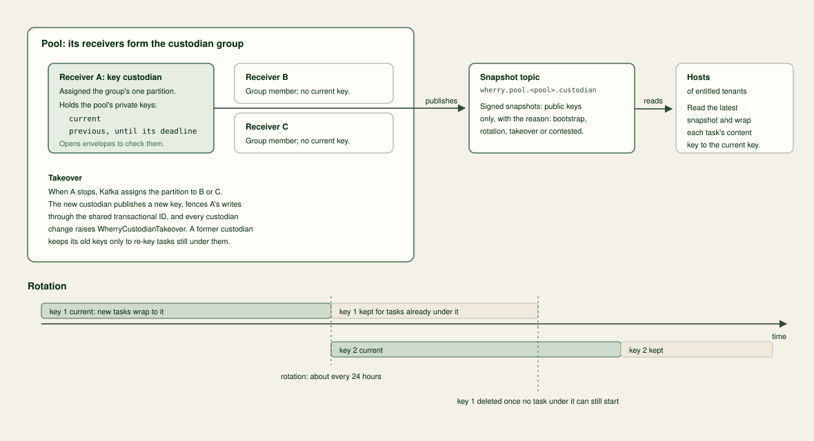
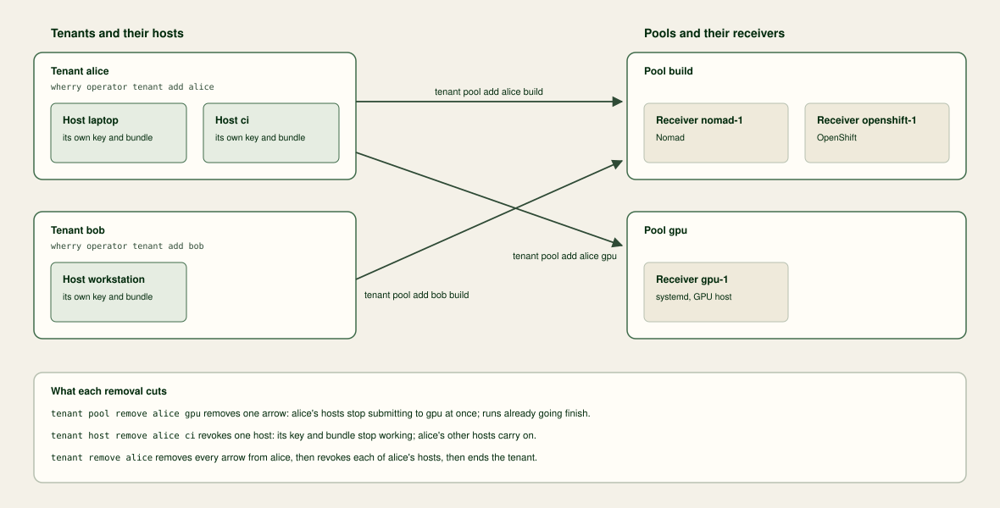

# Key concepts

[Introduction](introduction.md) states the problem wherry solves.
[Design](design.md) covers its topics and configuration delivery, and
[Security](security.md) its credential envelopes.

## Roles

- **The operator** runs `wherry operator`. It issues every Kafka principal,
  grants every ACL, and writes the records on `wherry.operator` that define
  pools, receivers, hosts and entitlements. The operator is close to root:
  `wherry operator init` uses the Kafka super user once to create the
  principal `wherry.operator`, whose `Alter` on the cluster lets it grant
  any ACL, and every later command connects as `wherry.operator`.
- **A tenant** submits work. Each tenant has one or more **hosts**,
  machines that run the `wherry` CLI or its MCP server. Each host is its
  own Kafka principal with its own Ed25519 signing key. A compromised host
  is a compromise of its tenant.
- **A pool** is a set of receivers that share terms and trust each other fully:
  one pool per trust and tenancy boundary; the platform is a label.
  Its terms name the agents it runs, the credentials each agent takes and their targets, the
  share-group delivery limit and lock duration, and the quotas its tenants'
  hosts get. A tenant is entitled to one or more pools. A host entitled through
  several pools gets the lowest of their quotas.
- **A receiver** is a long-running `wherry receiver run` process in one pool.
  It claims tasks, runs each as a platform job, and publishes the job's
  statuses, transcript and result. Each receiver is its own principal with
  an Ed25519 signing key, which it creates on first start and keeps in its
  state directory.
- **A plugin** is the binary `wherry-plugin-<type>` that runs
  jobs on one kind of platform. The receiver ships with none, and runs one
  plugin process per plugin from its plugin directory, linked to it
  by mutual TLS. Plugins exist for Nomad, Kubernetes and systemd.
- **A plugin profile** is a named, configured use of a plugin: the agent it
  launches, its labels and its runtime. A task is placed on a profile and a
  run is routed to one. A receiver holds one or more profiles, and each
  profile launches one agent.
- **The agent** is the program a job runs, such as a coding agent's
  headless command. wherry does not modify it. The receiver passes it a
  prompt file and reads its standard output.

A pool can name several agents, each launched through its own harness.

## Identity and authorisation

Identity is a Kafka principal authenticated with
[SCRAM-SHA-512](https://kafka.apache.org/documentation/#security_sasl_scram)
over TLS. `wherry operator` creates each host and receiver principal, sets a
generated password, and writes a **bundle**: a file, mode 0600, holding the
broker address, the principal and its password, and no CA: each machine
trusts the broker through the system roots or a CA file in its own
configuration. The operator hands the bundle to the host or receiver. It never travels over Kafka.

| Principal | Name |
| --- | --- |
| host | `wherry.tnt.<tenant>.<host>` |
| receiver | `wherry.rcv.<receiver>` |
| operator | `wherry.operator` |

Authorisation is
[Kafka ACLs](https://kafka.apache.org/documentation/#security_authz), enforced
by the broker. `wherry operator` generates every host and receiver ACL from
the state on `wherry.operator`. Each names one resource literally, except one
prefixed grant per receiver on its pool's transactional IDs.
`wherry.operator`'s own grants come from `operator init`, and two of them
are prefixed: topics `wherry.` and groups `p-`
([The operator principal](security.md#the-operator-principal)). The `wherry operator` command that
records a host or receiver on `wherry.operator` also issues its principal and ACLs,
and `tenant pool add` records an entitlement with its ACLs; no other approval step
exists. [Design](design.md#acls) lists the matrix.

## Placement

A task names an **agent** and a **selector**. The agent is a name from the
pool's terms; it is the one thing wherry itself interprets. The selector
is a list of requirements over labels, in the style of
[Kubernetes set-based selectors](https://kubernetes.io/docs/concepts/overview/working-with-objects/labels/#set-based-requirement).
The operators are `In`, `NotIn`, `Exists` and `DoesNotExist`;
[Commands](commands.md#selectors) gives the grammar.

**Labels describe characteristics**, such as a GPU, a network segment or an
isolation level. The operator declares them per plugin profile in the receiver's
configuration record. Keys are arbitrary and may carry the operator's own
prefix, such as `example.com/gpu`; the prefix `wherry.io/` is reserved.
Two profiles can launch the same agent with different labels, such as one
in containers and one on the host.
The runtime, node pool and datacenter a profile uses are part of its
configuration, not labels; the platform is a label the operator declares.

**Every label is routing information.** A profile's **signature** is its
agent plus all its labels: the ones declared for it and merged into the
profile, never its plugin configuration, so no runtime setting is selectable
unless the operator declares it as a label. Each signature in a pool has its
own task topic, `wherry.pool.<pool>.tasks.<agent>.<hex>`. Two profiles share a
signature, and so a queue, only when their agent and every label are
identical, byte for byte: members meant to share a queue carry identical
labels. One differing label is a different signature, and a task placed on it
waits for the members with that signature alone, even when the host spreads
new tasks across both by spare capacity. Identical labels do not prove that
the runtimes behind them have identical capabilities. Profiles that differ by
an absent label have different queues even when a selector omits that key:
`In` and `Exists` require the key, `NotIn` also matches an absent key, and
`DoesNotExist` requires its absence. Placement selects one matching
signature, and queued tasks do not overflow to another. No command checks
that interchangeable members carry identical labels.

**The client places a task on a signature before it signs.** It reads the
receiver configurations on `wherry.operator` for their labels, and the
advertisements on the receivers topic of each entitled pool for liveness,
capacity and which profiles are ready. A receiver whose latest advertisement
is at most 120 seconds old is live. For each live receiver, each agent the
task may run and each ready profile that launches it with labels the selector
accepts, the client counts the profile's signature, and adds the receiver's
spare capacity once to each signature it offers: an estimate, since a
receiver's capacity is partitioned by profile replicas; spare is an aggregate
estimate. With no agent named, a
signature of the pool's default agent wins over any other; with no
default-agent signature matching, the choice among the other agents'
signatures is by spare capacity. Among the signatures that remain, the one
with the most spare capacity wins, and ties go to the lowest topic name. A
selector no live signature satisfies is refused. The client signs the agent,
the selector and the chosen pool into the task and writes it to the
signature's task topic.

**Each profile replica subscribes** only to that profile's signature topic while
ready. A fresh task goes through the profile of the loop that claimed it,
including when profiles share a signature. The selector guards against a
host publishing to the wrong topic; it does not choose between profiles.
If the loop's profile becomes unready, it releases the task without an
offer-unavailable start failure. An ending run can still clean up its job
without a ready profile. A redelivery may adopt another profile's existing
job. Receiver-wide suspension and pending observations gate idle polling.

**A label change moves a signature.** `receiver apply` creating a profile's
new signature creates its topic before the record; the receiver restarts on
the new record and subscribes to the new topic. Tasks queued on the old topic
wait there unless another member shares the old signature, and their host
reports them unclaimed at `task_started_by`; a label change does not carry
them over. An operator who needs uninterrupted service quiesces the
submissions that target the affected signature first.

## Files in and out

Everything the task receives lands as files. A submission's `raw` and
`data` parts are input files that the agent finds in the directory
`WHERRY_INPUT_DIR` names. They travel inline in the submission record,
within the broker's record limit, which `pool apply` records, and the
limit each plugin profile declares. Over either, they go through S3 when the pool
has storage and the host a storage credential; otherwise submit refuses,
naming the limit. Credentials are files in the directory
`WHERRY_CREDENTIALS_DIR` names or environment variables, each at its
target. The receiver opens the prompt with the names of the files, the
credentials' targets and the outputs the task expects.

The agent leaves its outputs in the directory `WHERRY_OUTPUT_DIR` names.
Once the job ends and is stopped, whatever its exit, the plugin
collects the regular files there, up to 256 entries and the pool's output
limit (8 MiB by default), without
following links. The receiver redacts each file, publishes it in chunks on
the tenant's transcript topic in the result's transaction, and lists every
output in the result with the size and SHA-256 it computed, or with the
reason it was not returned. A required output that is not returned fails
the run. `wherry wait` verifies each output's chunks against the result
before it writes the file locally.

A pool can also carry files through an S3-compatible bucket its operator
names, up to 5 GiB each. The host uploads an S3 input with its own
credential before it publishes the task, and the task carries only the
input's name, size and SHA-256. At submit, the host presigns a short-lived
GET per input and a PUT per expected S3 output, and encrypts them with the
credentials in the task's envelope, so the URLs never sit on the broker in
the clear. The receiver checks each URL against the pool's
endpoint and bucket; the plugin fetches the inputs into the input
directory and verifies them; the receiver streams each S3 output to its
PUT URL, hashing what it sends, and lists it in the result. The host then
downloads and verifies the outputs and deletes the run's objects. The
host's storage credential never leaves the host, and S3 outputs, which go
to the host's own bucket, are not redacted.

A task can also name a git repository: a remote and a ref. The host's
`git` configuration gives the clone its credential and, for `ssh`, its host
key: the entry whose URL is the longest prefix of the remote. The credential
joins the task as a task credential in the file `git-credential`. The URL
prefix is the credential's scope, since every task cloning under it receives
the credential. A remote under no entry clones anonymously. The agent clones
it with `git` itself; wherry runs no git. The receiver delivers the host key
as the input file `known_hosts` and opens the prompt with the clone
commands, which read the credential from its file. The remote's host must
be one of the pool's VCS hosts. The agent returns its commits as a patch
or a bundle output, which the parent applies with its own credentials, or
pushes them to the branch `wherry/<run>` when the parent asks and its
credential allows.

## Runs and attempts

A run is one task from submission to its final state. It is one signed
submission and one execution, which ends in a terminal state. A receiver
may attempt that execution more than once.

Each pool reads its tasks through the Kafka
[share group](https://cwiki.apache.org/confluence/display/KAFKA/KIP-932%3A+Queues+for+Kafka)
`p-<pool>`. A receiver holds a claimed task through the share group's
acquisition lock for the whole run and renews it every 10 seconds. When a
receiver stops renewing, the broker delivers the task again, and that
delivery is the next attempt. The receiver that takes it looks for the
run's job in each of its plugin profiles. If the job exists and came from the
same profile and agent, as its platform metadata records, the receiver adopts it, opens the envelope for its own attempt,
and once it opens resumes the transcript from the run's latest committed
offset, which each holder records on its own progress topic,
`wherry.receiver.<receiver>.progress`. Any other job under the
run's ID is stopped and purged, and the run is dispatched again. Each
run writes through its own
[transactional producer](https://kafka.apache.org/documentation/#semantics),
`p.<pool>.<run>`, so an adopter fences the earlier holder's writes.

A status goes to the pool's events and the tenant feed in one transaction,
and every reader reads committed records only. The result and the **echo**
go to the tenant feed, and transcript and output chunks go to the tenant's
transcript topic, `wherry.tenant.<tenant>.transcript`, in the same
transaction as the status, result or progress record they belong to. While
the job runs, the receiver records the run's latest committed transcript
offset on its progress topic every 10 seconds. A terminal status carries
the number of transcript chunks its attempt wrote. The echo, written when a
receiver claims or rejects a run, names the pool and placement the run was
admitted to, so any host of the tenant can follow or cancel the run. The submitting
host also keeps a record of each run in its state directory, so it can report the
run before a receiver claims it.

A run passes through these records from submission to result.

## Pool keys and the key custodian

Each pool has a P-256 key pair.
One receiver holds the current private key as the pool's **key custodian**.
Your host encrypts credentials and presigned S3 links in a task envelope.
It wraps the envelope's content key to the pool's public key.
Your host can go offline after submission.

The claiming receiver requests the content key for its attempt.
The custodian checks the task and claim before releasing an attempt wrap.
[Credential envelopes](security.md#credential-envelopes) explains the checks.

All pool receivers join consumer group `p-<pool>.custodian`.
The member assigned the snapshot topic's partition becomes custodian.
It publishes signed public-key snapshots on `wherry.pool.<pool>.custodian`.
It stores private keys in its state directory.
Keep that directory across restarts.

A custodian crash can take the group's 45-second session timeout to detect.
A signalled stop leaves the group immediately.
A replacement publishes a `takeover` snapshot.
A fenced custodian can publish a `contested` snapshot.
Both raise [WherryCustodianTakeover](runbooks.md#wherrycustodiantakeover).
All receivers in a pool must trust each other.
[Key custody](design.md#key-custody) gives the election and transaction details.

### Rotation

The custodian rotates the pool key 24 hours after its first published snapshot, plus jitter under one hour.
Hosts use the new public key after reading its snapshot.
Queued tasks can still open under retained keys.

A replaced key is retained until its replacing snapshot's append time plus `start_by_limit` plus seven hours.
[Key custody](design.md#key-custody) explains restart deadlines.
For incident response, suspend the pool before using `wherry operator pool rotate-key`.
See [Respond to a compromised receiver or pool key](operations-operator.md#respond-to-a-compromised-receiver-or-pool-key).

### Planned drain and re-key

A stopping custodian leaves the group and waits for a successor's snapshot.
`drain_timeout` bounds that wait.
With a successor, it re-keys eligible tasks in one transaction and deletes its keys.
A failed scan or write keeps the keys until their deadlines.
A suspended pool keeps its keys without scanning tasks.

The stop finishes within `drain_timeout` plus five seconds.
With no successor, the receiver exits with its keys.
This includes a pool with only one receiver.
Tasks appended after the re-key scan can still fail under the old key.
Follow [Stop a pool's key custodian](operations-receivers.md#stop-a-pool-s-key-custodian).

### Lost pool keys

A task cannot open if no running receiver holds its pool key.
This can happen when a custodian loses its state directory.
Removing a pool's only receiver can also lose the keys.
The next custodian publishes a new key with reason `takeover`.
It waits up to five minutes for a re-key wrap before refusing an open request with `key unavailable`.

1. A job that has never started ends with `TASK_STATE_FAILED` and event `key-lost`.
2. An existing job is stopped and fails without `key-lost`.
3. A job whose lookup cannot answer stays reconciling until lookup succeeds or its end bound passes.

The submitting host can resubmit a `key-lost` run before its original `task_started_by`.
It resolves credentials again and creates a replacement run under the current key.
It preserves the original task content and absolute bounds.
`wait` follows the replacement chain.
[Resubmission](a2a-extension-v1.md#resubmission) lists the commands that trigger this recovery.

Recovery requires the submitting host's state and credential sources.
A host that never returns cannot recover a never-started task under a lost key.
A running job under a lost key cannot be adopted after its receiver fails.
Tasks submitted before a crash is detected can use the lost key and need resubmission too.

### Suspension

Use `wherry operator pool suspend POOL` to stop new starts.
The operator withdraws host Write access to the pool's task topics.
Receivers stop claiming new work.
The custodian refuses first starts and continues serving adoptions.
Running jobs can finish.

The command waits for the custodian to acknowledge suspension in its snapshot.
A pool without a custodian returns immediately.
If acknowledgement does not arrive within five minutes, the command fails.
New starts can still open until the custodian reads the suspension.

Suspension does not take credentials back from running jobs.
Rotate credentials at their issuer to invalidate them.
`wherry operator pool resume POOL` restores the grants and queued work can run.
See [Incident response](operations-operator.md#respond-to-a-compromised-receiver-or-pool-key).

## Cancellation

A cancel is a host-signed record on the pool's events that names a run.
A receiver reads cancels every 10 seconds, and checks them every second
for each run it holds. The receiver stops a running job, and a receiver
that claims a cancelled run starts no job. Either way the run ends in
`TASK_STATE_CANCELED`.

## Revocation

Revoking a host or receiver removes its access at the broker, in six
steps:

1. Record the principal as revoking on `wherry.operator`, then rotate its
   SCRAM password. From the revoking record on, the principal is granted
   no ACL, so an operator command that reconciles ACLs does not restore its
   grants. It stays a member until step 6.
2. Delete its ACLs.
3. Probe every broker as the principal, with the new password. While any
   broker still authorises it, the step probes again every second for up
   to 2 minutes, then fails. A refused login, as from a broker that has not
   yet applied the new password, is retried within the same 2 minutes. Any
   other probe error fails the step at once.
4. Delete its SCRAM credential.
5. Wait the longest of the broker's re-authentication, share-group lock
   and transaction timeout intervals. A longer wait can be asked for; a
   shorter one is refused.
6. Record its membership end on `wherry.operator`, then read
   `wherry.operator` to its end and delete again any ACL or credential a
   concurrent command restored.

No claim or write by the principal is authorised after step 5. A
revocation run again after a failed step continues from the revoking
record. Readers
reject its records once they read the step 6 record. A host also skips
every record a receiver wrote once that receiver's membership has ended,
including records it wrote before, so the runs it served lose that history
in `wait` and `events`.

A receiver exits at its first authorisation error, or once it reads its
membership ended. It stops claiming, serving open requests and key custody
at once, and leaves the jobs of the runs it holds running. Closing its
share sessions attempts to release their tasks: when the broker accepts
the release they are delivered again at once; otherwise, as under the
denial that stopped the receiver, they return when their locks lapse. On a pool-wide platform, such as Nomad or
Kubernetes, the next holder, the restarted receiver or another member,
adopts each job. A host-local platform, such as systemd, adopts only on the
same host: the receiver restarted under the same receiver ID adopts its
jobs, but a member on another host that claims a task starts a second job
once the [claim check](a2a-extension-v1.md#the-claim-check) no longer counts
the exited receiver a live claimant, as after a receiver crash. A systemd
receiver therefore needs a signature of its own: give each systemd profile a
`host: <name>` label, so only the receiver restarted on that host serves its
signature and adopts its runs.
The receiver leaves jobs running for adoption.

A revoked principal does not return. A host or receiver that comes back is
provisioned under a new name, with a new principal and key topic.

A compromised key calls for revocation. A
[key rotation](operations-hosts.md#rotate-a-key) keeps the retired key
verifying the owner's feed and transcript records from before the
rotation.

## Tenants

A tenant groups hosts and their access to pools.
Create it explicitly with `wherry operator tenant add TENANT`.
That command creates its feed and transcript topics.
Host creation and entitlement changes require a live tenant.

An **entitlement** gives a tenant access to a pool.
Add it with `wherry operator tenant pool add TENANT POOL`.
Remove it with `wherry operator tenant pool remove TENANT POOL`.
Removal stops new admissions and placement for that tenant in the pool.
You can add the entitlement again.

A tenant moves through three states:

1. Absent: no tenant record exists.
2. Live: hosts and entitlements can belong to it.
3. Ended: its name cannot be reused.

Remove a tenant with `wherry operator tenant remove TENANT`.
The operator ends its entitlements first.
It then revokes its hosts before recording the tenant's end.
Removal keeps retained data and host keys.
See [Removal and retained data](security.md#removal-and-retained-data).
