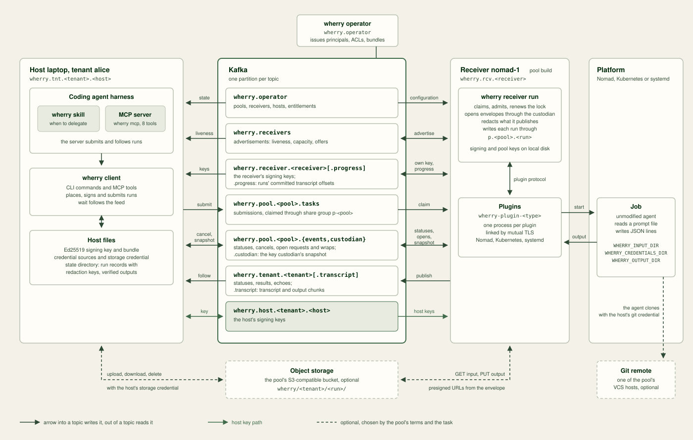

# Design

How wherry lays its records out on Kafka, how a receiver gets its
configuration, and the topics and ACLs `wherry operator` creates.

## Why Kafka

wherry puts Kafka at the centre of identity, authorisation, task
distribution and history, and runs no server of its own. Each need is one
Kafka already meets:

- identity is a SCRAM principal over TLS, and authorisation is ACLs the
  broker enforces;
- a share group hands each task to one receiver, holds it under a renewed
  acquisition lock, and redelivers it when that receiver dies;
- transactions fence an earlier attempt and commit a run's last records
  together;
- the log is the history every host and receiver reads, and a topic per
  audience keeps each reader to its own records.

The cost is a Kafka cluster to operate: version 4.3, with share groups, a
SCRAM listener and an authoriser, as
[Prepare Kafka](operations.md#prepare-kafka) lists. An organisation that
already runs Kafka adds topics and principals to it.

## Topics

Kafka cannot filter records on the broker, so records consumed
differently live on different topics.

| Topic | Writers | Readers | Holds |
| --- | --- | --- | --- |
| `wherry.operator` | the operator | every principal | pool terms, receiver configurations, hosts, entitlements, revocations in progress, membership ends, pool suspensions and resumes, rotate-key requests |
| `wherry.receivers` | receivers | receivers, hosts | advertisements |
| `wherry.receiver.<receiver>` | that receiver | its pool's members, entitled tenants' hosts | its keys |
| `wherry.receiver.<receiver>.progress` | that receiver | its pool's live members | each run's latest committed transcript offset |
| `wherry.pool.<pool>.tasks` | entitled tenants' hosts | the pool's receivers, through its share group | submissions |
| `wherry.pool.<pool>.events` | the pool's receivers, entitled tenants' hosts | the pool's receivers | statuses, start failures, cancels, open requests, attempt wraps, re-key wraps, open refusals, claim decisions |
| `wherry.pool.<pool>.custodian` | the pool's receivers | the pool's receivers, entitled tenants' hosts | custodian snapshots |
| `wherry.tenant.<tenant>` | receivers of the tenant's pools | the tenant's hosts | statuses, results, echoes |
| `wherry.tenant.<tenant>.transcript` | receivers of the tenant's pools | the tenant's hosts | transcript chunks, output chunks |
| `wherry.host.<tenant>.<host>` | that host | that host, receivers of the tenant's pools | its key |

`wherry.operator` can also read and write every one of these topics
through its prefixed grant on `wherry.` topics ([ACLs](#acls)).

A host and a receiver read and write these topics as their grants allow,
beside the platform, object storage and git remote a run uses.

`wherry.operator` records and progress records carry no signature: each
sits on a topic one wherry principal writes, so Kafka authenticates it.
`wherry.operator` itself can write every `wherry.` topic through its
prefixed grant ([ACLs](#acls)), and its holder is trusted as the operator. Every other record, key
records included, is a versioned EdDSA
[JWS](https://datatracker.ietf.org/doc/html/rfc7515). A record on a shared topic
names its owner and key in its `kid`, and a reader verifies it against that
owner's current key, read from the owner's own key topic, before it decodes the
payload. A host reading its tenant feed and transcript topic, and a receiver
reading its pool's statuses, also accept a key the owner has rotated away,
for records the broker appended before that rotation. No host or receiver
can vouch for another's key.

A reader then checks the record against `wherry.operator`. A submission or
cancel must come from a live host of a tenant entitled to the pool whose
topic it arrived on. A receiver record must come from a live member of the
pool the run was placed in, on behalf of a tenant entitled to it.
[The wherry A2A extension](a2a-extension-v1.md) specifies every record.

Every topic has one partition and `LogAppendTime` timestamps, and no topic
is deleted. `wherry.receivers` and the progress topics have
`cleanup.policy=compact,delete`: their readers need only the latest record
per key. Only its receiver writes a progress topic. Every receiver can write
`wherry.receivers`, so a reader keeps each key's latest record that
verifies as its owner's. A pool's snapshot
topic has `cleanup.policy=compact`: its readers need only the latest
committed snapshot, under its one key, and only the pool's receivers and
`wherry.operator` can write it. Every other topic has `cleanup.policy=delete`.

A pool's task and event topics and its receivers' progress topics keep
records for its `start_by_limit` plus six hours plus a day, 4 days 6 hours
by default. An update to a shorter `start_by_limit` lowers none of them: they
keep the longer terms' retention, with the events and progress topics at
least at the tasks topic's. The tenant feed and transcript topic keep them for 30
days and `wherry.receivers` for 7. The identity and configuration topics
keep them forever, and so does a pool's snapshot topic.

A deployment has 2 + 2R + 3P + 2T + H topics for R receivers, P pools, T
tenants and H hosts. The count depends on configuration alone.

Every principal reads all of `wherry.operator`, so tenants see each other's
names, hosts, entitlements and pools.

## Configuration delivery

A receiver's configuration is a record on `wherry.operator`: its capacity
(the runs it holds at once) and its plugin profiles, each with a name, its plugin's
type, an agent, labels and its merged settings for the plugin. It holds no
secrets and names no agent credential: every profile of an agent delivers
the agent's credentials as the pool's terms give them. A profile's settings
may name a platform credential, whose source the receiver's local
configuration holds. `wherry operator` refuses a configuration that names an
agent outside the pool's terms.

A receiver starts with its local configuration, which names its bundle, a
state directory, a plugin directory and the sources of its platform
credentials. It registers its signing key, waits for its configuration
record, validates it against the terms and configures its profiles. It then advertises every 30 seconds.
Each receiver joins its pool's custodian group; the member the group
assigns the snapshot topic's partition is the pool's key custodian. It
holds the pool's P-256 private keys in its state directory, publishes the
current public key in the pool's snapshot topic through the shared
transactional ID `p.<pool>.custodian`, which fences any earlier custodian,
rotates the key daily, and answers each open request on the pool's events
with an attempt wrap or a refusal
([Pool keys and the key custodian](concepts.md#pool-keys-and-the-key-custodian)).
When a new configuration record appears, the receiver stops claiming, lets
the runs it holds end and exits, so its platform restarts it with the new
configuration. A restart through its platform applies a change at once: the
receiver stops within its `drain_timeout` and releases the tasks it holds,
and runs in flight are then adopted on redelivery.

## Kafka resources

### Topics

`wherry operator` creates each topic with one partition, the broker's default
replication factor, `cleanup.policy=delete` and
`message.timestamp.type=LogAppendTime`, except `wherry.receivers` and the
progress topics, which it creates with `cleanup.policy=compact,delete`,
`segment.ms=3600000` and `max.compaction.lag.ms=3600000`, so a segment
closes and compacts within an hour, and a pool's snapshot topic
`wherry.pool.<pool>.custodian`, which it creates with
`cleanup.policy=compact`. A pool's tasks and events topics have
`segment.ms=3600000`, so retention deletes a record within an hour of its
bound, and `retention.bytes=-1`, so no size limit, the broker's
`log.retention.bytes` included, deletes one sooner; `operator check` verifies
both, their `cleanup.policy=delete` and their single partition. Partitions
cannot be removed, so `pool apply` and `operator check` refuse a
tasks or events topic with more than one; the remedy is to recreate the pool's topics. A tenant feed and transcript topic also
have `max.message.bytes=2097152`, the 2 MiB a receiver batches, so a result
naming 256 outputs fits.

| Topic | Created by | `retention.ms` |
| --- | --- | --- |
| `wherry.operator` | `operator init`, then any recording command when missing | `-1` |
| `wherry.receivers` | `operator init`, then any recording command when missing | `604800000` (7 days) |
| `wherry.pool.<pool>.tasks` | `pool apply` | at least `start_by_limit` plus 30 hours, in milliseconds; default `367200000`; `pool apply` never lowers it |
| `wherry.pool.<pool>.events` | `pool apply` | at least tasks; `pool apply` raises it to tasks and never lowers it |
| `wherry.pool.<pool>.custodian` | `pool apply` | `-1`, outside the pool retention bound |
| `wherry.tenant.<tenant>` | `pool entitle`, `host add` | `2592000000` (30 days) |
| `wherry.tenant.<tenant>.transcript` | `pool entitle`, `host add` | as the tenant feed, `2592000000` (30 days) |
| `wherry.receiver.<receiver>` | `receiver apply` | `-1` |
| `wherry.receiver.<receiver>.progress` | `receiver apply`, `pool apply` | at least the pool's tasks topic; never lowered |
| `wherry.host.<tenant>.<host>` | `host add` | `-1` |

The tasks retention keeps `start_by_limit`, the six-hour maximum run time,
and a one-day margin. Events and the pool's progress topics stay at least as
long as tasks. A tenant feed and its transcript topic must stay for at least
`start_by_limit` plus six hours; their 30-day default exceeds the
default requirement of `280800000`. Identity and configuration topics stay
at `-1`, and `wherry.receivers` remains a seven-day liveness topic.

`wherry operator` leaves an existing topic's configuration as it is, except
that every recording command sets the configuration above on
`wherry.receivers`, `pool apply` sets the retention, never
lowering it, timestamp type, `cleanup.policy`, `retention.bytes` and `segment.ms` of the pool's tasks and events topics and
the configuration of its snapshot topic, and `receiver apply` and `pool apply` set every
configuration above on the progress topics of the pool's live receivers, never lowering their retention.
`pool entitle` and `pool apply` set `max.message.bytes` on
existing tenant feeds and transcript topics. A
tenant feed's or transcript topic's retention can be changed with Kafka's
own tools. `pool apply` and `pool entitle` refuse terms that need more than
an entitled tenant's feed or transcript topic keeps, and `wherry operator
check` reports a topic below its bound, a progress topic that keeps less
than its pool's tasks topic, and a pool topic whose timestamp type is not
`LogAppendTime`, a tasks or events topic without the hourly `segment.ms`,
and a snapshot topic whose configuration differs from the above or that has
more than one partition.

### ACLs

Every grant allows from any host. Resources are literal except the
receivers' transactional ID prefix and `wherry.operator`'s prefixed grants,
which `operator init` gives ([The operator principal](security.md#the-operator-principal)).

| Principal | Resource | Operations |
| --- | --- | --- |
| `wherry.operator` | cluster | Alter, AlterConfigs |
| `wherry.operator` | topic prefix `wherry.` | Create, AlterConfigs, Read, Write |
| `wherry.operator` | group prefix `p-` | AlterConfigs |
| host | topic `wherry.operator` | Read, Describe |
| host | topic `wherry.receivers` | Read, Describe |
| host | topic `wherry.tenant.<own tenant>` | Read, Describe |
| host | topic `wherry.tenant.<own tenant>.transcript` | Read, Describe |
| host | topic `wherry.host.<own tenant>.<own host>` | Read, Write, Describe |
| host | topics `wherry.pool.
.tasks` and `.events`, each entitled pool | Write, Describe |
| host | topic `wherry.pool.
.custodian`, each entitled pool | Read, Describe |
| host | topic `wherry.receiver.<r>`, each receiver of an entitled pool | Read, Describe |
| receiver | topic `wherry.operator` | Read, Describe |
| receiver | topic `wherry.receiver.<own>` | Read, Write, Describe |
| receiver | topic `wherry.receiver.<own>.progress` | Read, Write, Describe |
| receiver | topic `wherry.receiver.<peer>`, each other member of its pool, live or ended | Read, Describe |
| receiver | topic `wherry.receiver.<peer>.progress`, each other live member of its pool | Read, Describe |
| receiver | topic `wherry.receivers` | Read, Write, Describe |
| receiver | topic `wherry.pool.<own pool>.tasks` | Read, Describe |
| receiver | topic `wherry.pool.<own pool>.events` | Read, Write, Describe |
| receiver | group `p-<own pool>` | Read, Describe, DescribeConfigs |
| receiver | topic `wherry.pool.<own pool>.custodian` | Read, Write, Describe |
| receiver | group `p-<own pool>.custodian` | Read, Describe |
| receiver | transactional ID prefix `p.<own pool>.` | Write, Describe |
| receiver | topic `wherry.tenant.<t>`, each tenant entitled to its pool | Write, Describe |
| receiver | topic `wherry.tenant.<t>.transcript`, each tenant entitled to its pool | Write, Describe |
| receiver | topic `wherry.host.<t>.<h>`, each host of those tenants | Read, Describe |

A principal whose membership has ended, or whose revocation is under way,
has no grants. While a pool is [suspended](commands.md#wherry-operator-pool-suspend-pool),
its hosts hold Describe alone on its tasks topic: they lose Write. Every
other grant stays.
