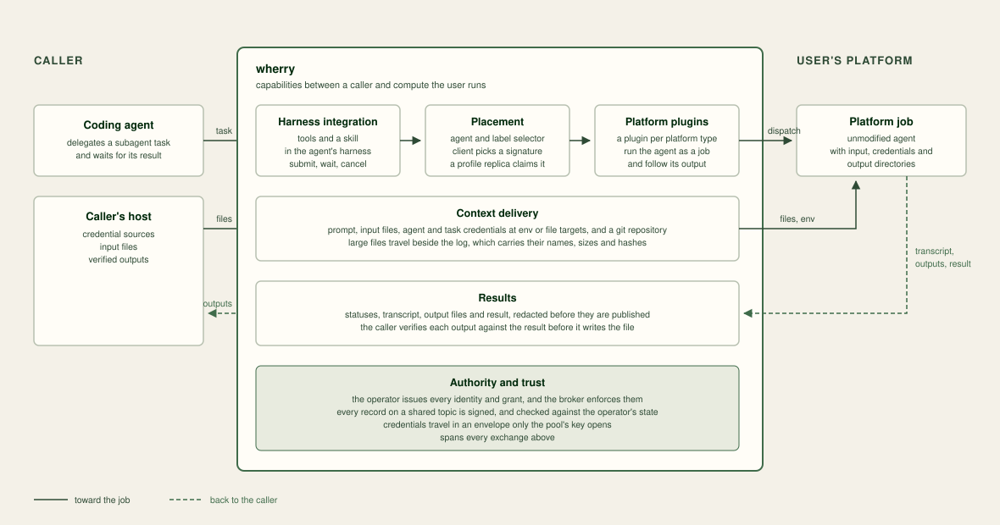

# Introduction

A coding agent that delegates work runs its subagents on the machine the
agent itself runs on, or in the agent vendor's cloud. Neither is
infrastructure its user operates, so a subagent cannot use the user's own
clusters, hardware, network placement or isolation.

wherry sends a subagent task to a platform the user runs, starts an
unmodified agent there, and returns the result to the caller. Every
exchange is a record on a Kafka cluster the user also runs. Kafka supplies
identity, authorisation, isolation, history, work distribution and atomic
writes.

## What wherry is

wherry is an execution fabric for delegated agent work, built on Kafka. It
hands a coding agent's work to the containers, sandboxes and clusters that
run agents, across machines, tenants and trust boundaries, and returns the
result.
[Why wherry](index.md#why-wherry) sets out what it gives, and
[Key concepts](concepts.md) explains the model.

wherry is open source under the Mozilla Public License 2.0 and has no
hosted control plane. The hosts, the receivers, the Kafka cluster and the
object storage are all the user's, so the tasks, their files and their
results stay on infrastructure the user governs.
[Where your data goes](governance.md#where-your-data-goes) traces each one.

wherry's capabilities sit between the caller and the platform that runs
the agent.

## What ships

One `wherry` binary with four roles:

- **Operator:** `wherry operator init` delegates provisioning from the Kafka
  super user to the `wherry.operator` principal. `wherry operator` then
  creates pools and their terms, entitles tenants, adds hosts and receivers
  with their Kafka principals, ACLs and bundles, records receiver configurations, revokes access, suspends and
  resumes pools and rotates their keys, and checks the result against the
  broker.
- **Host:** `wherry host init` places the host's bundle, registers its
  signing key, prints its key ID, and asks for a source for each credential
  the tenant's pools take. `wherry host key rotate` replaces the key.
  `wherry host receivers` lists the receivers the tenant may use with their
  plugin profiles and labels. `submit` places a task by agent and label selector and publishes
  it with its credentials in the task's envelope. `wait`, `status`,
  `events` and `cancel` follow and stop a run. `status` without a run ID lists every run the host
  can see, and `logs` prints a run's agent output. `wherry submit`, `wait`,
  `status`, `events`, `logs` and `cancel` are shortcuts for these `wherry host`
  commands. `wherry host mcp` serves `receivers` and these six as MCP tools of
  the same name; see
  [Harness integration](operations.md#harness-integration).
- **Receiver:** `wherry receiver run` claims its pool's tasks and runs each one
  as a job on one of its profiles, through a plugin, such as
  the Nomad plugin from
  [wherry-plugins](https://github.com/benemon/wherry-plugins). The plugin
  protocol is the Go module in
  [`pluginsdk`](https://github.com/benemon/wherry/tree/main/pluginsdk).
- **Developer:** `wherry dev` runs a whole deployment on one machine, with a
  Nomad dev agent, a single-broker Kafka and one receiver, for trying wherry
  and developing against it.

Submissions, statuses, transcript chunks and results are A2A v1.0 objects.
[The wherry A2A extension](a2a-extension-v1.md) specifies every record.

Tenants are created explicitly with `wherry operator tenant add`. Pool entitlements and hosts belong to an existing live tenant. Tenant removal revokes access and permanently ends its name; it does not erase retained data.
