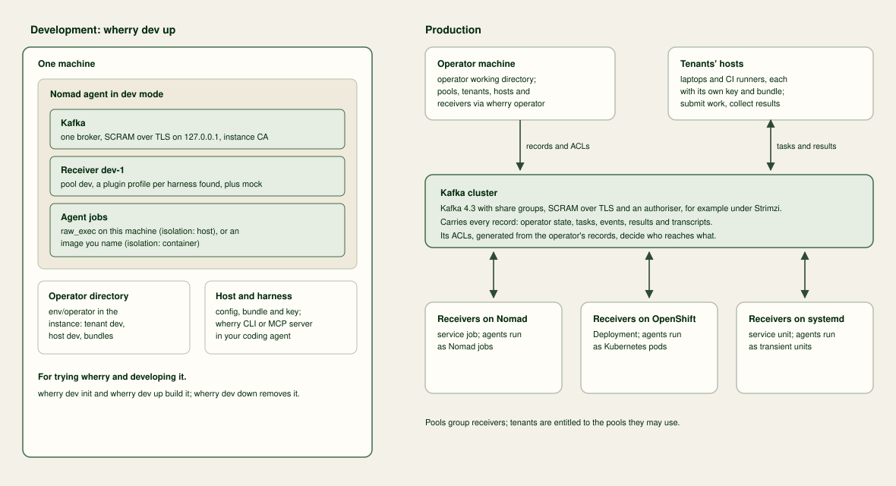

# Introduction

## What is wherry?

wherry is an execution fabric for delegated agent work built on Kafka.
You run its hosts, receivers and Kafka cluster on infrastructure you control.
A receiver starts an unmodified agent through a platform plugin.
The host receives the result and output files.

wherry is open source under the Mozilla Public License 2.0.
It has no hosted control plane.
[Governance](governance.md) explains where your data goes.

## What can you use wherry for?

Use wherry to hand off work that needs another machine's network, hardware or isolation.
You can share receivers across teams and follow a run after its submitting session ends.
The [six use cases](use-cases.md) describe these workflows.

## How does wherry work?

1. The operator creates pools, tenants, entitlements and receiver identities.
2. You enrol a host for your tenant.
3. Your host selects a pool and profile for a task and publishes a signed submission to Kafka.
4. A receiver claims the task and obtains its credential envelope through the pool's key custodian.
5. A plugin runs the agent on your platform.
6. Your host follows status and transcript records and collects the result.

Kafka enforces principal access through ACLs.
wherry signs shared records and checks returned files against their digests.
[Key concepts](concepts.md) explains the roles and trust boundaries.
[Design](design.md) explains the topics and records.

## Where do you start?

Follow the [production quickstart](quickstart-production.md) to run a first task on Nomad.
For a local trial, follow the [development quickstart](quickstart-development.md).
