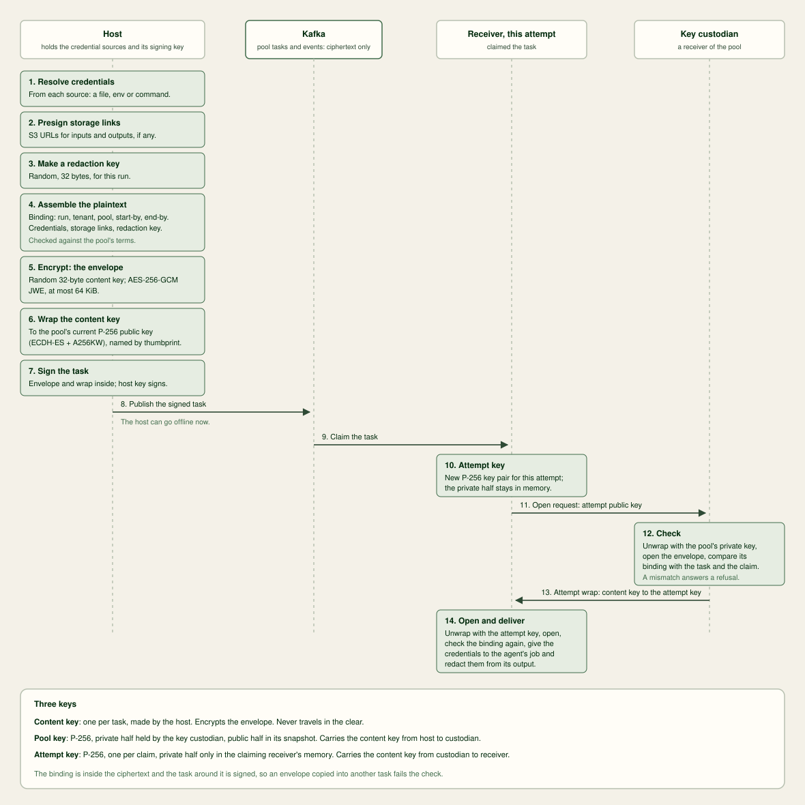

# Security

Your host resolves credentials when you submit a task.
The credential envelope carries their values to the run's receiver.
This page explains credential delivery and its trust boundaries.
[Governance](governance.md) covers identity, grants and the audit trail.

## Credential envelopes



The agent usually needs a model credential, and each tenant's work runs on
that tenant's own credential. Every credential has a **source** on the
host and a **target** in the agent. The pool's terms list each agent's
credentials, each with its target: an environment variable or a file in
the directory `WHERRY_CREDENTIALS_DIR` names, and whether the agent
requires it. The host's [client configuration](configuration-host.md#client-configuration)
maps each credential name to one [source](#credential-sources). A task can
also declare **task credentials**: credentials of the host, such as a
deploy key, that the agent gets at the target the task's parent chooses.
The pool's terms do not govern them, and none may take the target of one of
the agent's credentials or of another task credential. Only the agent's run
can read its credentials, and the platform's boundary enforces it, as each
[plugin](plugins.md)'s README states.

`wherry host receivers` lists each agent's credential names with their
targets, marking those this host has no source for, such as
`credentials=openai-api-key:env=OPENAI_API_KEY,github-token:env=GH_TOKEN(missing,optional)`. `wherry
submit` refuses a task at once, with
`auth required: credential <name> is not in this host's configuration`,
when the host has no source for a required credential of the placed agent
or for a task credential. An optional credential the host has no source for
is not delivered, and the prompt names it as not supplied.

A host resolves each credential's [source](#credential-sources) and
presigns the run's S3 links when it submits, and encrypts them, with the run's
redaction key, in the task's **envelope**: a compact JWE (`dir` with
`A256GCM`, through [go-jose](https://github.com/go-jose/go-jose)) of at most
64 KiB under a fresh content key, bound to the task's run, tenant, pool,
`task_started_by` and `task_ended_by`. The task's **wrap** carries the
content key to the pool's current key, which the pool's key custodian holds
and publishes in its [snapshot](a2a-extension-v1.md#custodian-snapshot).
The host signs the task with both in it, and can go offline once `submit`
returns.

The pool's snapshot topic, `wherry.pool.<pool>.custodian`, holds the
custodian's signed snapshots: public keys only. The pool's receivers read
and write it, and the hosts of entitled tenants read it. `wherry.operator`
can also read and write it, through its prefixed grant on `wherry.` topics
([The operator principal](#the-operator-principal)); no other wherry
principal has a grant on it ([ACLs](design.md#acls)). A host takes the latest
committed snapshot alone, refuses to submit when its writer is not the
custodian it names or that custodian is not a live member of the pool, and
never falls back to an earlier snapshot.

The receiver that claims a run makes a P-256 key for that attempt and
writes an **open request** on the pool's events. The key custodian checks
the claim and answers with an **attempt wrap**, the content key encrypted to
the attempt's key, or a refusal. The key custodian opens the envelope
itself to check its binding against the task before it wraps the content
key ([The claim check](#the-claim-check)), and a receiver holding a
replaced pool key decrypts it to check a content key before it re-keys it.
Of the claimants, only that attempt of that receiver opens the envelope:
the attempt's private key lives in the receiver's memory until the
envelope opens or the wait ends. A receiver whose request no key
custodian answers within 5 minutes and 120 seconds releases the task to the
pool. A run that never started and whose envelope no holder of a pool key
can open ends `TASK_STATE_FAILED` with the wherry event `key-lost`, and its
host resubmits it under the pool's current key until its `task_started_by`
([Lost pool keys](concepts.md#lost-pool-keys)).

The receiver redacts each credential of 8 bytes or more that it delivered,
with or without its trailing newline and as JSON escapes it, from
everything it publishes for the attempt. Each marker is an HMAC of the
credential's name under the run's redaction key, so no marker maps to a
name without that key. A credential whose marker would contain a delivered
value is replaced by `[*]` instead, so no replacement writes a value back. The receiver redacts no value shorter than 8 bytes
once its trailing CR and LF are removed, and logs
`run <id>: credential <name> too short to redact`.

An agent that finds a credential missing or refused during the run reports
`TASK_STATE_AUTH_REQUIRED` naming the credential, and the run ends
`TASK_STATE_FAILED`. The message names its credentials in `credential` data
parts, and the run is not resumed.

Everything else the agent needs comes from the platform or from the task:
the image or host install, network access, CA bundles and SSH known hosts
from the platform, and files and task credentials from the task.

## The claim check

The custodian checks an open request before releasing an attempt wrap.
It verifies all of these:

1. The request comes from a live receiver in the pool.
2. The request names the run's admitted task and current claim.
3. The task came from an authorised host and has valid bounds.
4. The run has no terminal status or cancellation.
5. The request is within its start bound or adoption end bound.
6. The pool permits the start or the claimant is adopting an existing job.
7. Any previous holder released its claim, ended its membership or passed its advertisement lease.

The custodian records its claim decision durably.
It refuses a competing claim with `two live claimants` while the previous holder remains live.
The advertisement lease is 120 seconds.
The [claim-check specification](a2a-extension-v1.md#the-claim-check) defines ordering, task hashes and evidence checks.
[Pool suspension](concepts.md#suspension) explains the acknowledgement boundary.

A refused claimant acts on the reason:

| Reason | Claimant's action |
| --- | --- |
| `two live claimants`, `not the current claimant`, `pool suspended` | releases the task to the pool |
| `terminal` | acknowledges the task without a run |
| `past its bound`, `envelope invalid` | ends the run `TASK_STATE_FAILED` |
| `key unavailable` | decides from the run's job, as [Lost pool keys](concepts.md#lost-pool-keys) describes |

[Open refusal](a2a-extension-v1.md#open-refusal) gives each action in full.

## What the envelope binds

The envelope's `binding` holds the task's run, tenant, pool,
`task_started_by` and `task_ended_by`. The key custodian checks it against
the signed task before it wraps the content key, and the claimant checks it
again at open, so an envelope copied into another task fails:

- under another run, tenant or pool, the binding differs and the envelope
  does not open;
- under the same run once the original is claimed, the copy is another hash,
  not the run's task: admission rejects it and the key custodian refuses its
  open, since the run's task is the first hash with a status other than
  `rejected` among live pool members' statuses
  ([Admission](a2a-extension-v1.md#admission));
- under the same run after retention has deleted the original, the copy must
  carry the original's bounds, which have passed, so admission rejects it.

The binding does not protect the task's other members, such as its message,
placement and outputs. They rest on the host's signature and on first-wins
admission. A record from any other host names a run ID its signer does not
derive, so admission rejects it and it never becomes the run's task; only the
Kafka operator, which is root, can append a record that is claimed before the
original. Receivers cannot read the binding at
admission: a malformed first task can win its run and then fail at open with
`envelope invalid`.

## Envelope bounds

- **Size.** An envelope is at most 64 KiB, and the signed task with its
  envelope must fit the pool's record limit; `submit` measures the actual
  record. `pool apply` sizes the pool against a task with a maximum
  envelope ([Size a pool against the broker](operations-operator.md#size-a-pool-against-the-broker)).
- **Time on the broker.** The pool's tasks and events topics keep records for
  `start_by_limit` plus six hours plus a day, or longer after `pool apply`
  shortens `start_by_limit`, since it never lowers their retention, and roll a segment every hour,
  so retention deletes a record within about an hour of that bound; an
  envelope's exposure is that retention plus the broker's deletion lag.
  Attempt wraps, re-key wraps and refusals live on the events topic and
  expire with it. The snapshot topic is compacted and kept forever, and holds
  public keys only.
- **Presigned links.** A host presigns an S3 input's GET until
  `task_started_by` plus 15 minutes and an S3 output's PUT until
  `task_ended_by`, each at most 7 days, the longest an
  [S3 SigV4](https://docs.aws.amazon.com/AmazonS3/latest/userguide/using-presigned-url.html)
  presigned URL lasts. For a pool with storage, `start_by_limit` plus six
  hours must not exceed 7 days. The host signs with its static storage
  credential, so the 7-day ceiling and those deadlines are the only bounds
  on a link.

## What the pool key protects

The pool is the trust boundary: its receivers trust each other fully.
A malicious member of the pool forging claim evidence, initialising the
custodian's transactional ID, publishing a snapshot naming itself with any
reason, or withholding re-key wraps is out of scope.

| Party | What it gets |
| --- | --- |
| Kafka operators and broker storage | ciphertext only, without a pool private key |
| another tenant or pool | nothing: the platform's ACLs, TLS and SCRAM keep them apart, and only the pool's receivers and `wherry.operator` can write its snapshot and its advertisements |
| a compromised receiver that is not the key custodian | the credentials of the runs it claims; it can become custodian through the custodian group as any pool member can, which raises [WherryCustodianTakeover](runbooks.md#wherrycustodiantakeover), as every custodian change does |
| the key custodian, or anyone who copies its keys | every retained envelope under those keys, without claiming |

Daily [rotation](concepts.md#rotation) stops a silently copied key from
receiving new tasks within 25 hours: the custodian rotates 24 hours plus a
jitter under one hour after the key's snapshot. Deleting a key at its deadline protects
old envelopes only if the key was never copied.

### Trade-offs of pool custody

The pool's key custodian holds the key that opens every task's envelope, so
no attempt needs an answer from the submitting host. Custody in the pool:

- lets the host go offline once `submit` returns: retries, takeovers and
  drains need no answer from it;
- keeps the envelope on the chosen pool's task topic alone;
- gives a [weaker guarantee](concepts.md#lost-pool-keys) when the
  custodian's keys are lost: never-started tasks under them fail and run
  only when their host resubmits them before their `task_started_by`,
  including tasks submitted between the custodian's crash and its
  successor's snapshot;
- keeps each run's non-secret task content, and its redaction key, on the
  host, so the host can resubmit; the host keeps no credential value in
  the clear.

## Run credentialed tasks

Prerequisites: a host with its
[client configuration](configuration-host.md#client-configuration), entitled to a
pool whose terms list the agent's credentials.

1. Map each credential the agent takes, and each task credential, to a
   [source](#credential-sources) in `credentials` of the host's
   configuration:

   ```yaml
   credentials:
     openai-api-key:
       file: ~/.config/wherry/credentials/openai
     github-token:
       env: GITHUB_TOKEN
     vault-token:
       command: [vault, print, token]
   ```

2. Run `wherry host receivers` and check that the agent lists no required
   credential as `missing`.

3. Submit the task. Give each task credential its target with
   `--credential NAME:file=FILE` or `--credential NAME:env=VAR`. `submit`
   resolves each source and refuses the task, naming the credential, when
   one fails.

4. When the run ends `TASK_STATE_FAILED` naming a credential, fix that
   credential's source and submit a new run.

## A model credential per pool

An agent holds the credentials delivered to its run.
It can send them anywhere its network permits.
Use a dedicated, revocable model credential for each tenant's use of a pool.
You can then revoke that credential without affecting other pools.
Your provider controls its scope and usage limits.

wherry delivers the value resolved by the host's source.
It does not check the provider account or key scope.
Choose a credential name used by that pool alone.
Map it to the tenant's source on each host.

### Give a pool's agents a dedicated credential

Prerequisites: the [operator working directory](operations-operator.md#set-up-wherry-operator),
the pool's terms in `pools/<pool>.yaml`, and, for each tenant entitled to the pool, a model
provider account that issues and revokes API keys, such as per-project or
per-workspace keys.

1. Choose a credential name for the pool alone, such as
   `build-anthropic-api-key` for pool `build`.

2. For each tenant entitled to the pool, issue a key at the model provider
   for the pool's agents, scoped to the models and limits the pool's runs
   need.

3. On each of the tenant's hosts, map the name to a
   [source](#credential-sources) holding that key:

   ```yaml
   credentials:
     build-anthropic-api-key:
       command: [op, read, "op://wherry/build-anthropic/credential"]
   ```

4. Name the credential in the pool's terms, at the target the agent reads
   it from, and record the terms as in
   [Change a pool's terms](operations-operator.md#change-a-pool-s-terms):

   ```yaml
   agents:
     - name: claude
       credentials:
         - {name: build-anthropic-api-key, env: ANTHROPIC_API_KEY}
   ```

   ```sh
   wherry operator pool apply build
   ```

   The credential is required unless the entry sets `required: false`, so
   `wherry submit` refuses a task for the agent from a host with no source
   for it.

5. On each host, run `wherry host receivers` and check that the agent lists
   `build-anthropic-api-key` without `missing`.

### Rotate a pool's credential

Prerequisites: a host of the tenant whose key rotates, and the tenant's
account at the model provider.

1. Issue a new key at the model provider for the pool's agents.
2. Replace the value at the credential's source on each of the tenant's
   hosts. `submit` resolves the source for each run, so runs submitted
   afterwards get the new key with no restart.
3. Wait for the runs submitted with the old key to end. `wherry status`
   lists each run and its state.
4. Revoke the old key at the model provider.

### Revoke a pool's credential

Prerequisites: the tenant's account at the model provider.

1. Revoke the key at the model provider. Agents still running with it get
   refused calls; an agent that reports the refusal ends its run
   `TASK_STATE_FAILED` naming the credential.
2. Remove the value from the credential's source on each of the tenant's
   hosts, or replace it with a new key as in
   [Rotate a pool's credential](#rotate-a-pool-s-credential). Until a source
   resolves, `submit` refuses runs that deliver the credential.

When a receiver is revoked, rotate each credential it could open, as in
[Revoke a host or receiver](operations-operator.md#revoke-a-host-or-receiver).

A revoked or denied receiver leaves the jobs it held running for adoption,
as [Revocation](concepts.md#revocation) describes.

## Credential sources

A submitting host, and a host resubmitting a run, resolves each source the
run delivers for the run's [envelope](a2a-extension-v1.md#submission). The
configuration holds no value and no source prompts.

| Source | Value |
| --- | --- |
| `file` | the file's contents as they are; a trailing newline is part of the value the agent gets, and the receiver redacts the value with and without it |
| `env` | the variable in the submitting process's environment; unset or empty fails the submission |
| `command` | the standard output of the program, run without a shell with the submitting process's environment and no standard input, byte for byte as for a file; standard error is discarded |

A `command` source runs with `WHERRY_TASK_END_BY` set to the task's
`task_ended_by` as an RFC 3339 time in UTC, in place of every copy the
process would inherit; the submitting process's own environment is
unchanged.

A command has 60 seconds, time for an interactive unlock such as a password
manager's, and at most 64 KiB of output. A command that exits non-zero, runs
out of time or writes more fails the submission, which names the
credential and the cause alone:

```
resolve credential <name>: its command exited with status 1
```

A `file` source must name a regular file that its group cannot write and
others cannot read, write or execute. Mode 0600 is the recommended mode.
Group read is accepted, so a secrets agent can template the file for a
service group at mode 0640. A file that breaks the rule fails the submission:

```
resolve credential <name>: its file is writable by its group or open to others; chmod 600 it
```

The `submit` of the [MCP server](mcp.md) refuses as an input every file
a `file` source names, including the storage keys' files.

### Suggested sources

[`wherry host init`](commands.md#wherry-host-init) asks for each credential's
source and writes the configuration with the reference it is given, `file`,
`env` or `command`: a path, a variable's name or an argv, never a value. When
an agent's target variable is set where `init` runs, it offers that variable,
defaulting to No:

```
pool build delivers credential git-token to its agents as GITHUB_TOKEN.
found GITHUB_TOKEN in your environment. Use it for git-token? It will be sent to agents in every pool, now or later, that names git-token. [y/N]
an environment source is read where submits run, including the MCP server your harness starts.
```

A source belongs to the credential name across pools: whatever the
variable holds goes to the agents of every pool that names the credential,
including pools the tenant is entitled to later. A variable set in a shell is
often set for another purpose, such as the user's own `GITHUB_TOKEN`, with
more reach than an agent needs, so only an explicit `y` takes it, and a blank
answer asks for a source instead. An `env` source is read in each process that
submits, so the MCP server a harness starts must have the variable too. A
file target suggests nothing, and a configuration written in advance or
without a terminal is used as written.

## Platform credentials

A receiver takes the credential a plugin authenticates to its platform
with, such as a Nomad token, from a source on the receiver's host. A
plugin profile's `config` names the credential with `credential: <name>`, and the
`credentials` of the receiver's [local
configuration](configuration-receiver.md#receiver-local-configuration) map the name
to a `file`, `env` or `command` source. The receiver resolves it with the
host's implementation and under the host's rules: the same file mode rule,
the same 60-second command timeout with standard error discarded, and
errors that name no path or value. An `env` or `command` source uses the
receiver's environment. The receiver trims a trailing CR and LF from the
value and passes it to the plugin when it configures the profile, at start
and after a configuration change.

[Platform credentials](configuration-receiver.md#platform-credentials) states what
`wherry.operator` and the bundle hold of it. A rotated platform token takes
effect on the receiver's next start without a new bundle.

## Git credentials

`submit` matches a git input's remote, written as an `ssh://` or `https://`
URL, against the `url` of each `git` entry and takes the entry with the
longest matching prefix, as git's `credential.<url>` settings do. The entry's
credential joins the task as a task credential the agent gets as the file
`git-credential` in `WHERRY_CREDENTIALS_DIR`, and the contents of its
`host_key` file become the git input's host key. A remote no entry matches
clones without a credential. The pool's [`vcs`](configuration-operator.md#pool-terms) hosts still
decide which hosts a remote may name.

The `url` prefix is the credential's scope: every task cloning under it
receives the credential, so a prefix ends with `/` and names no more than the
credential grants. Loading the configuration refuses a `url` that does not
start with `https://` or `ssh://` or repeats another, a `credential` with no
source in `credentials`, and a `host_key` that is not a readable file.

The storage keys resolve through their credentials' sources whenever the
host uploads, presigns, downloads or deletes, with surrounding whitespace
removed. Loading the configuration refuses a `storage` block missing either
name, or naming a credential with no source in `credentials`. A source that
fails names the credential and the cause:
`read storage credential <name>: its environment variable is unset or empty`.
The credential never leaves the host: receivers and agents get only the URLs it presigns.
Scope it to `wherry/<tenant>/` in each pool's bucket
([Operations](operations-hosts.md#s3-storage)).

## The Kafka super user

[`wherry operator init`](commands.md#wherry-operator-init) uses the Kafka
super user once, to delegate provisioning to the principal
`wherry.operator`, and then closes its connection. It takes the super user
from its flags or prompts each time, and writes neither its name nor its
password, nor the path of its password file, to any file. Every other
`wherry operator` command connects as `wherry.operator` alone, so the super
user's password can stay with the Kafka administrator after setup, and a
re-run of `init` to rotate `wherry.operator`'s password needs it again.
On Strimzi, the User Operator must ignore the principals wherry creates, as
[Strimzi](operations-operator.md#strimzi) shows.

### The operator principal

`init` grants `wherry.operator` these ACLs, which a real-broker test pins:

| Resource | Operations | Used by |
| --- | --- | --- |
| Cluster | `Alter` | creating and deleting SCRAM credentials; creating, describing and deleting ACLs |
| Cluster | `AlterConfigs` | client quotas; reading broker settings |
| Topic, prefix `wherry.` | `Create`, `AlterConfigs`, `Read`, `Write` | the operator, receiver, pool, tenant and host topics |
| Group, prefix `p-` | `AlterConfigs` | share-group settings |

Kafka implies `Describe` by `Read`, `Write` and `Alter`, and
`DescribeConfigs` by `AlterConfigs`
([authorization](https://kafka.apache.org/documentation/#security_authz_primitives)),
so `init` grants neither. `operator check` reports any of these grants
that is missing.

`Alter` on the cluster lets its holder grant itself any ACL, so
`wherry.operator` is close to the super user in effect: whoever holds
`operator.password` can take over the cluster. The super user's credential
is neither kept nor used after setup, and `wherry.operator`'s password
rotates with a re-run of `init`.

### The operator working directory

The operator's [working directory](configuration-operator.md#operator-working-directory)
holds `operator.password` and every bundle `tenant host add` and `receiver apply`
write, so it holds the Kafka password of every principal wherry made. Keep it
on the operator's machine, readable by the operator alone: `bundles/` is
mode 0700 and each password and bundle file mode 0600. `init` adds
`operator.password` and `bundles/` to the directory's `.gitignore`, so the
pool and receiver files can be kept in git without them. Hand each bundle to
its host or receiver over a channel you trust.

### Broker trust

A bundle carries the broker address, the principal and its password, and no
CA. Every host, receiver and the operator trusts the broker through the
system's trusted roots, or through the CA file its own configuration names:
`ca_file` in the host's or receiver's configuration (the host also looks for
`ca.pem` in its [configuration directory](configuration-host.md#client-configuration),
by default `~/.config/wherry/ca.pem`) and in `operator.yaml`. `wherry host init`
asks for the CA only on a terminal, so a host without one has its CA file in
place before `host init` connects. The Kafka platform issues
and renews its CA; whoever distributes a private CA keeps each machine's
file current, and a renewal needs no new bundle. A machine that trusts the
system roots trusts every CA they hold for the broker's address.

## Removal and retained data

Removing a tenant or an entitlement revokes access. Run data stays where it is; tenant removal deletes only the
tenant's bundle files.

The pool's receivers keep some grants after an entitlement ends, so runs they already hold can finish:

- Write and Describe on the tenant's feed and transcript topics.
- Read and Describe on every host key topic of the tenant, including ended hosts.

Only a receiver's own revocation removes these grants. They follow current pool membership, so a receiver that joins
the pool later also gets them, and those receivers can read the key topic of a host added later. The over-grant
allows writes to a feed the tenant's hosts ignore for that pool, and reads of public keys.

What happens to work after an entitlement ends:

- Unclaimed tasks, and redeliveries of claimed ones, fail admission. The receiver writes nothing for them.
- Running jobs finish normally into the tenant's feed. The tenant's hosts can no longer read or cancel them.
- A run waiting for its pool key is refused its open, and the receiver releases the task. Its next admission
  rejects it.
- A job whose run was released or whose receiver restarted mid-run is not adopted. The plugin's sweep cleans it up.

Residue and manual cleanup after revocation:

- Feed and transcript topics `wherry.tenant.<T>` and `wherry.tenant.<T>.transcript` retain data for 30 days; delete the topics with Kafka's Admin API when no retained work needs them.
- Host public key topics `wherry.host.<T>.<H>` are kept forever; delete them manually after revocation and retained work completes.
- Tenant statuses remain on shared pool events for pool retention. Wait for retention; deleting the shared topic also deletes other tenants' statuses.
- S3 objects under the tenant's prefix remain until the bucket lifecycle rule deletes them; delete that prefix manually if needed.
- Receivers' kept grants above remain until manually deleted with the Admin API; operator convergence restores grants derived from the log. Coordinate cleanup with stopping retained work and removing receivers.
- Host removal leaves its client quota; delete its user quota with the Admin API. Tenant removal deletes live hosts' quotas before revoking them; previously ended hosts' quotas require manual cleanup.

Tenant removal erases only the tenant's bundle files.
